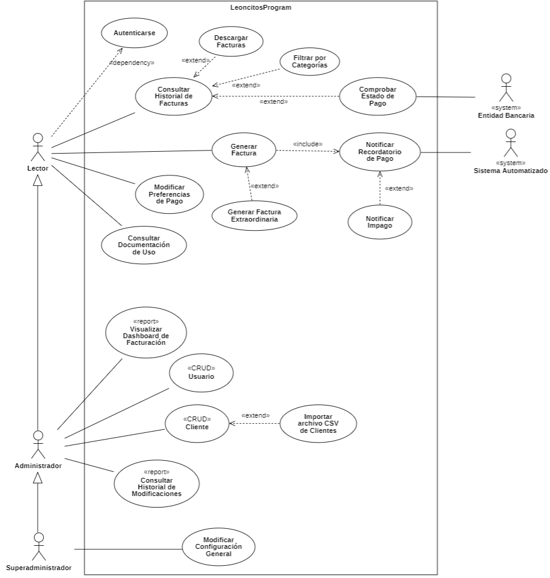

# Entrega 1 · Actualización

**Asignatura:** Análisis y Diseño de Aplicaciones · Grupo A · 2026–27  
**Equipo:** Leoncitos
**Integrantes:** Daniel Delgado, Wail Amchi El Haskouri, José Javier Jimenez, Daniel López, Jesús García, Fernando Montero
**Fecha:** 19/11/2026
**Repositorio:** https://github.com/13danilopez/Proyecto-ADAP-Leoncitos

---

## 1. Introducción y alcance

> Nuestro objetivo general planteado para este proyecto es el siguiente:

- **Objetivo**: Generar una plataforma simple, ágil e intuitiva que automatice la gestión de pagos y cobros de la empresa. El enfoque de la plataforma debe ser de uso exclusivo interno e independiente de BrainOS, y los clientes no deben tener acceso a ella. Se hace especial énfasis en garantizar la fiabilidad de los procesos automáticos (facturación, seguimiento de cobros), la trazabilidad de las modificaciones realizadas ("historial"), y la modularidad de la implementación software para facilitar futuras ampliaciones.

> Declaramos los siguientes aspectos como incluidos/excluidos del alcance de este proyecto:

- **Dentro de nuestro alcance contemplamos**:
	- La gestión de los usuarios registrados por parte de los administradores.
	- La gestión de los importes de las facturas según el rango de facturación del cliente.
	- La generación automática y veloz de facturas.
	- La gestión automática de las notificaciones de pago/impago.
	- Un dashboard que muestre informes de contabilidad (facturación semanal, mensual y anual).
	- El acceso a funciones de configuración del sistema y control de permisos (máximo privilegio) por parte del superadministrador.
	- Un mecanismo de trazabilidad de las modificaciones de datos de usuarios y facturas.
	- La gestión de los datos de la aplicación a través de una base de datos externa a la de TurbineH (ellos implementarán la suya).

- **Fuera de nuestro alcance quedan**: 
	- La creación de una pasarela de pago propia (gestión del cobro).
	- La integración de las cuentas de Stripe o Revolut.
	- La implementación de la IA de BrainOS en la plataforma (automatización sin IA implementada).
	- Un sistema de servicio de atención al cliente (comunicación a través del contacto de la empresa).
	- La conexión de la plataforma con la base de datos de la empresa y la plataforma de pago que usan.
	- El desarrollo de una GUI avanzadas que se adapten a una estética determinada.

---

## 2. Requisitos

## 1. Contexto y alcance

### 1.1. Objetivo del sistema

> Breve descripción del problema que se pretende resolver y del objetivo general del sistema.

- **Problema**: Reside principalmente en la carga de trabajo administrativo que supone gestionar manualmente la facturación y seguimiento de cobros de TurbineH, el cual ahora mismo se realiza de manera manual y requiere estar pendiente de los plazos de los clientes y de las fechas, modificaciones, recordatorios por impago, etc.

- **Objetivo**: Generar una plataforma simple, ágil e intuitiva que automatice la gestión de pagos y cobros de la empresa. El enfoque de la plataforma debe ser de uso exclusivo interno e independiente de BrainOS, y los clientes no deben tener acceso a ella. Se hace especial énfasis en garantizar la fiabilidad de los procesos automáticos (facturación, seguimiento de cobros), la trazabilidad de las modificaciones realizadas ("historial"), y la modularidad de la implementación software para facilitar futuras ampliaciones.

### 1.2. Alcance

> Descripción de qué responsabilidades corresponden al sistema y, cuando sea relevante, qué elementos quedan explícitamente fuera de su alcance.

- **Dentro de nuestro alcance contemplamos**:
	- La gestión de los usuarios registrados por parte de los administradores.
	- La gestión de los importes de las facturas según el rango de facturación del cliente.
	- La generación automática y veloz de facturas.
	- La gestión automática de las notificaciones de pago/impago.
	- Un dashboard que muestre informes de contabilidad (facturación semanal, mensual y anual).
	- El acceso a funciones de configuración del sistema y control de permisos (máximo privilegio) por parte del superadministrador.
	- Un mecanismo de trazabilidad de las modificaciones de datos de usuarios y facturas.
	- La gestión de los datos de la aplicación a través de una base de datos externa a la de TurbineH (ellos implementarán la suya).

- **Fuera de nuestro alcance quedan**: 
	- La creación de una pasarela de pago propia (gestión del cobro).
	- La integración de las cuentas de Stripe o Revolut.
	- La implementación de la IA de BrainOS en la plataforma (automatización sin IA implementada).
	- Un sistema de servicio de atención al cliente (comunicación a través del contacto de la empresa).
	- La conexión de la plataforma con la base de datos de la empresa y la plataforma de pago que usan.
	- El desarrollo de una GUI avanzadas que se adapten a una estética determinada.

### 1.3. Actores y partes interesadas

> Identificar las personas, organizaciones o sistemas que interactúan con el sistema o tienen algún interés relevante en su funcionamiento.

La organización principal que va a interactuar con este sistema es la propia empresa de TurbineH.

| Actor / stakeholder                         | Descripción                                                            | Intereses principales                                                                     |
| ------------------------------------------- | ---------------------------------------------------------------------- | ----------------------------------------------------------------------------------------- |
| Personal administrativo                     | Personal de Turbine encargado de gestionar clientes, facturas y cobros | Realizar las tareas administrativas de forma rápida y disponer de información actualizada |
| Superadministrador                          | Usuario con máximo nivel de privilegios                                | Gestionar configuración del sistema y permisos de otros usuarios                          |
| Administrador y lector                      | Usuarios con permisos sobre la gestión de los clientes                 | Gestionar clientes y facturas                                                             |
| Sistema externo de pagos (Stripe y Revolut) | Servicio externo en el que se reflejan los cobros                      | Proporcionar información que permita determinar si una factura ha sido pagada             |
| Cliente de Turbine                          | Empresa a la que Turbine presta sus servicios y factura periódicamente | Recibir correctamente sus facturas y comunicaciones relacionadas con los pagos            |
| Personal de contacto/soporte                | Personal de Turbine encargado del soporte al usuario                   | Comunicarse fácilmente a través de los medios acordados (e-mail y WhatsApp)               |

## 2. Requisitos de negocio

> Los requisitos de negocio describen los objetivos, necesidades o resultados que la organización pretende conseguir mediante el desarrollo del sistema. No describen todavía funcionalidades concretas del software.

| ID    | Requisito                                                                                  | Fuente               |
| ----- | ------------------------------------------------------------------------------------------ | -------------------- |
| BR-01 | Disponer de una plataforma de facturas y cobros propia de la empresa                       | Cliente / entrevista |
| BR-02 | Reducir el tiempo del personal administrativo en las operaciones                           | Cliente / entrevista |
| BR-03 | Agilización de los pagos                                                                   | Cliente / entrevista |
| BR-04 | Autogestión fiable de las facturas para minimizar posibles errores por gestión manual      | Decisión de equipo   |
| BR-05 | Facilitar la trazabilidad de las operaciones de pago                                       | Cliente / entrevista |
| BR-06 | Disponer de información sobre la facturación económica de la empresa semanal/mensual/anual | Cliente / entrevista |
| BR-07 | Poder disponer de un modelo escalable según el número de usuarios                          | Decisión de equipo   |

## 3. Requisitos de usuario

> Los requisitos de usuario describen las necesidades, objetivos o servicios que los punto de vista del usuario, evitando entrar todavía en detalles internos de implementación.

| ID    | Actor                   | Requisito                                                                                                      | Fuente               |
| ----- | ----------------------- | -------------------------------------------------------------------------------------------------------------- | -------------------- |
| UR-01 | Personal administrativo | Poder generar y gestionar facturas de los clientes sin tener que realizar manualmente cada facturación mensual | Cliente / entrevista |
| UR-02 | Personal administrativo | Poder conocer qué facturas están pagadas y cuáles siguen pendientes                                            | Cliente / entrevista |
| UR-03 | Administrador           | Poder gestionar los usuarios (lectores) del sistema y determinar a qué clientes puede acceder cada uno         | Cliente / entrevista |
| UR-04 | Personal administrativo | Poder iniciar sesión (no registrarse) con su correo corporativo y contraseña                                   | Cliente / entrevista |
| UR-05 | Superadministrador      | Poder modificar la configuración general del sistema                                                           | Cliente / entrevista |
| UR-06 | Administrador           | Poder dar de alta a clientes                                                                                   | Cliente / entrevista |
| UR-07 | Personal administrativo | Poder consultar un historial de facturas y descargarlas                                                        | Cliente / entrevista |
| UR-08 | Lector                  | Poder crear facturas (puntuales, por fecha y recurrentes) y consultar su estado                                | Cliente / entrevista |
| UR-09 | Administradores         | Tener acceso al dashboard informativo del sistema                                                              | Cliente / entrevista |

## 4. Requisitos del sistema

### 4.1. Requisitos funcionales

> Los requisitos funcionales describen comportamientos, servicios u operaciones que debe proporcionar el sistema. Siempre que sea posible, deben formularse de manera clara, precisa y verificable.

| ID    | Requisito                                                                                                                                                                                                                                                                                                        | Relacionado con                                                                                                 |
| ----- | ---------------------------------------------------------------------------------------------------------------------------------------------------------------------------------------------------------------------------------------------------------------------------------------------------------------- | --------------------------------------------------------------------------------------------------------------- |
|       | **GESTIÓN DE CLIENTES**                                                                                                                                                                                                                                                                                          |                                                                                                                 |
| FR-01 | El sistema permitirá dar de alta un cliente (empresa) con sus datos comerciales y fiscales: nombre, nombre comercial, razón social, NIF, dirección fiscal, país, moneda de trabajo y datos de contacto                                                                                                           | BR-01, UR-06, FR-02, FR-03, FR-04, FR-06, FR-07, FR-08, FR-09, FR-16, FR-17, FR-40, FR-41, NFR-13               |
| FR-02 | Los datos de contacto serán un email o teléfono                                                                                                                                                                                                                                                                  | UR-06, FR-01, FR-03, FR-59, FR-60                                                                               |
| FR-03 | El sistema deberá poder almacenar varios contactos de la empresa de cada cliente                                                                                                                                                                                                                                 | UR-06, FR-01, FR-02, FR-55, FR-59, FR-60                                                                        |
| FR-04 | El sistema deberá mostrar varios datos de interés en la "ficha" de cada cliente: inicio de plan, tipo de plan, responsable comercial, condiciones de pago                                                                                                                                                        | UR-06, FR-01, FR-05, FR-07, FR-09, FR-11, FR-15, FR-17, FR-23, FR-79                                            |
| FR-05 | El sistema deberá poder adjuntar otros documentos firmados con el cliente fuera de la plataforma (acuerdo comercial)                                                                                                                                                                                             | UR-06, FR-04, NFR-10, NFR-13, NFR-14                                                                            |
| FR-06 | Todo cliente o dato modificado se guardará inmediatamente y podrá editarse en cualquier momento posterior                                                                                                                                                                                                        | UR-06, FR-01, FR-71, FR-91, NFR-06                                                                              |
| FR-07 | El sistema asignará a cada cliente un rango de facturación anual, del que depende su cuota                                                                                                                                                                                                                       | UR-06, RB-05, A-03, FR-01, FR-04, FR-08, FR-43, FR-44, FR-45, FR-71, FR-81                                      |
| FR-08 | Al dar de alta un cliente se indicará si su facturación es recurrente o no (puntual), junto con su rango de facturación y la cantidad                                                                                                                                                                            | UR-01, UR-06, RB-05, FR-01, FR-07, FR-16, FR-19, FR-20, FR-25, FR-43                                            |
| FR-09 | El cliente tendrá un estado (activo, inactivo/pausa, baja solicitada, baja)                                                                                                                                                                                                                                      | UR-06, RB-04, FR-01, FR-04, FR-10, FR-11, FR-12, FR-13, FR-14, FR-41, FR-71                                     |
| FR-10 | Distinción entre plan de cliente en pausa (motivo, fecha prevista de reactivación) o de baja (baja de los servicios confirmada por empresa)                                                                                                                                                                      | UR-06, RB-04, FR-09, FR-12, FR-13, FR-14                                                                        |
| FR-11 | El sistema permitirá etiquetar clientes de forma flexible (estratégico, beta, partner, riesgo de cobro, etc.). Diferente a los estados                                                                                                                                                                           | UR-06, FR-04, FR-09                                                                                             |
| FR-12 | La baja de un cliente será un borrado lógico: sus datos se conservarán durante el plazo que permita la ley                                                                                                                                                                                                       | UR-06, RB-04, A-02, FR-09, FR-10, FR-82, NFR-13, NFR-14                                                         |
| FR-13 | Al solicitar la baja o pausa del servicio, el sistema cancelará automáticamente la recurrencia y no generará nuevas facturas para los periodos contemplados durante los plazos afectados                                                                                                                         | UR-01, UR-06, RB-04, FR-09, FR-10, FR-14, FR-20, FR-24                                                          |
| FR-14 | Si el cliente tiene facturas impagadas, la baja no se completará: se le notificará y se mantendrá el flujo de seguimiento hasta que se complete esa transacción independientemente del estado de la suscripción sin generar nuevas facturas por los servicios que hayan quedado en pausa o se hayan dado de baja | UR-02, UR-06, RB-04, FR-09, FR-10, FR-13, FR-31, FR-51, FR-58                                                   |
| FR-15 | Cada cliente tendrá un usuario de Turbine asignado como responsable                                                                                                                                                                                                                                              | UR-03, FR-04, FR-17, FR-18, FR-52, FR-62                                                                        |
| FR-16 | El sistema permitirá importar clientes de forma masiva mediante un archivo CSV                                                                                                                                                                                                                                   | BR-02, UR-06, FR-01, FR-08, NFR-01, NFR-05                                                                      |
| FR-17 | El sistema permitirá asignar cada cliente a un departamento interno de Turbine facilitando su organización y consulta, se contemplará como un campo opcional no necesario dentro de la creación del cliente                                                                                                      | UR-06, FR-01, FR-04, FR-15                                                                                      |
|       | **GESTIÓN DE FACTURAS**                                                                                                                                                                                                                                                                                          |                                                                                                                 |
| FR-18 | El sistema permitirá crear facturas puntuales para un cliente                                                                                                                                                                                                                                                    | BR-02, UR-01, UR-08, RB-03, FR-08, FR-20, FR-22, FR-23, FR-26, FR-33, FR-35, FR-39, FR-42, FR-55, FR-69, NFR-01 |
| FR-19 | El sistema permitirá crear facturas recurrentes (mensuales) para un cliente                                                                                                                                                                                                                                      | BR-02, BR-04, UR-01, UR-08, FR-08, FR-13, FR-19, FR-24, FR-25, FR-42, FR-43, FR-55, FR-69, NFR-07, NFR-08       |
| FR-20 | El sistema permitirá crear una facturas rectificativas con los datos iniciales de la última factura emitida en caso de no poder modificarla por motivos legales. Se conservará la factura original y la rectificativa estará referenciada a esta                                                                 | UR-01, RB-03, FR-22, FR-32, FR-33, FR-34, FR-37, FR-86, NFR-15                                                  |
| FR-21 | El importe de una factura será editable únicamente en el momento de su creación (si es incorrecto se deberá crear una factura rectificadora)                                                                                                                                                                     | UR-01, RB-03, FR-19, FR-21, FR-29, FR-32, FR-70, NFR-15                                                         |
| FR-22 | El plazo de pago por defecto de una factura será de 5 días desde su emisión                                                                                                                                                                                                                                      | UR-01, FR-04, FR-19, FR-24, FR-51, FR-56, FR-57, FR-79                                                          |
| FR-23 | Las facturas recurrentes se generarán y enviarán automáticamente entre el día 1 y 5 de cada mes                                                                                                                                                                                                                  | BR-02, BR-04, UR-01, FR-13, FR-20, FR-23, FR-25, FR-55, FR-96, NFR-07, NFR-08                                   |
| FR-24 | Si un cliente se da de alta a mitad de mes, se emitirá una factura proporcional a los días restantes, y la siguiente el día 1                                                                                                                                                                                    | BR-02, BR-04, UR-01, RB-06, A-04, FR-08, FR-20, FR-24, FR-43                                                    |
| FR-25 | El sistema permitirá generar automáticamente un PDF de cada factura con un formato estandarizado                                                                                                                                                                                                                 | BR-02, UR-01, UR-07, FR-19, FR-27, FR-28, FR-30, FR-38, FR-55, FR-85, NFR-15                                    |
| FR-26 | El contenido del PDF será idéntico al guardado en la aplicación y al enviado al cliente (no pueden haber incoherencias)                                                                                                                                                                                          | UR-07, FR-26, FR-28, FR-36, FR-55, FR-85, NFR-15                                                                |
| FR-27 | Las facturas se almacenarán en la base de datos y cada cliente tendrá su historial completo                                                                                                                                                                                                                      | BR-05, UR-07, FR-26, FR-27, FR-42, FR-72, FR-91, NFR-06, NFR-14                                                 |
| FR-28 | Las facturas serán editables antes de la emisión de la misma con cambios trazables                                                                                                                                                                                                                               | BR-05, UR-01, FR-22, FR-32, FR-35, FR-37, FR-70, FR-91, NFR-20                                                  |
| FR-29 | Las facturas podrán ser descargadas en PDF por los usuarios                                                                                                                                                                                                                                                      | UR-07, FR-26, FR-72, FR-92, NFR-10                                                                              |
| FR-30 | Cada factura tendrá un estado (pendiente, pagada, vencida/impagada, incobrable y condonada), asignable mediante un menú con las etiquetas predefinidas.                                                                                                                                                          | UR-02, UR-08, FR-14, FR-42, FR-47, FR-49, FR-51, FR-52, FR-53, FR-54, FR-70, FR-72, FR-87, FR-88, FR-97         |
| FR-31 | Una factura podrá modificarse hasta el cierre del trimestre natural de su fecha; después quedará bloqueada                                                                                                                                                                                                       | UR-01, RB-03, FR-21, FR-22, FR-29, NFR-15                                                                       |
| FR-32 | Las facturas serán numeradas con una serie y número identificador dentro de esa serie (configurable por superadministrador)                                                                                                                                                                                      | UR-01, UR-05, FR-19, FR-21, FR-34, FR-35, FR-36, FR-86, NFR-15                                                  |
| FR-33 | Los números de serie de facturas rectificativas y normales deben ser distintos                                                                                                                                                                                                                                   | UR-01, FR-21, FR-33, FR-86                                                                                      |
| FR-34 | Una factura en borrador (todavía no creada) no consume un número identificador                                                                                                                                                                                                                                   | UR-01, FR-19, FR-29, FR-33, FR-37                                                                               |
| FR-35 | El reenvío de una factura en caso de un error no cambia el identificador de la misma (que no se generen duplicados)                                                                                                                                                                                              | UR-01, FR-27, FR-33, FR-96, NFR-08, NFR-09                                                                      |
| FR-36 | El borrador de una factura puede ser eliminado, pero no una factura ya emitida                                                                                                                                                                                                                                   | UR-01, RB-03, FR-21, FR-29, FR-35, NFR-15                                                                       |
| FR-37 | El sistema permitirá generar facturas multi-idioma con los idiomas preseleccionados por la empresa de Turbine                                                                                                                                                                                                    | UR-01, FR-26, FR-55, FR-85                                                                                      |
| FR-38 | El sistema permitirá generar facturas extraordinarias para servicios u operaciones que no formen parte de la facturación habitual del cliente. Debe ser revisada y aprobada por un administrador o superadministrador antes de su emisión                                                                        | UR-01, FR-19, FR-43, FR-46, FR-64, FR-78                                                                        |
|       | **BÚSQUEDA Y FILTRADO DE CLIENTES Y FACTURAS**                                                                                                                                                                                                                                                                   |                                                                                                                 |
| FR-39 | Se podrán buscar clientes por nombre y NIF                                                                                                                                                                                                                                                                       | UR-03, UR-06, FR-01, FR-41, FR-42, FR-76, NFR-06                                                                |
| FR-40 | Se podrán filtrar clientes por país, sector, estado, fecha de alta                                                                                                                                                                                                                                               | UR-03, UR-06, FR-01, FR-09, FR-40, FR-76, NFR-06                                                                |
| FR-41 | Se podrán filtrar facturas por estado (pagada, pendiente, impagada), tipo (recurrente, puntual) y fecha                                                                                                                                                                                                          | UR-02, UR-07, UR-08, FR-19, FR-20, FR-28, FR-31, FR-40, FR-90, NFR-06                                           |
|       | **TARIFAS Y RECURRENCIA**                                                                                                                                                                                                                                                                                        |                                                                                                                 |
| FR-42 | La cuota mensual se calculará según una tabla de rangos de facturación anual, configurable por el superadministrador. Excepcionalmente se calculará según precios pactados o descuentos extraordinarios, aplicados en la creación de la factura automáticamente                                                  | UR-01, UR-05, RB-05, FR-07, FR-08, FR-20, FR-25, FR-39, FR-44, FR-45, FR-46, FR-81                              |
| FR-43 | La cuota de un cliente será constante durante todo el año, incluso si se cambia el rango de facturacion de la empresa, por criterios de de seguimiento de la empresa. Sólo cambiará en caso de descuentos extraordinarios o precios pactados                                                                     | UR-01, RB-05, FR-07, FR-43, FR-45, FR-46                                                                        |
| FR-44 | El sistema avisará cada año de la revisión de los rangos de facturación de cada cliente                                                                                                                                                                                                                          | UR-01, A-03, FR-07, FR-43, FR-44, FR-64, FR-81                                                                  |
| FR-45 | El sistema permitirá solicitar descuentos extraordinarios o establecer precios pactados para determinados clientes. Estas solicitudes deberán incluir una justificación y requerirán la aprobación de un administrador antes de aplicarse                                                                        | UR-01, UR-05, FR-39, FR-43, FR-44, FR-64, FR-78, FR-91                                                          |
|       | **SEGUIMIENTO DE COBROS**                                                                                                                                                                                                                                                                                        |                                                                                                                 |
| FR-46 | El sistema consultará automáticamente el sistema de cobros (como mínimo Stripe) para comprobar si una factura está pagada                                                                                                                                                                                        | BR-03, UR-02, A-01, FR-31, FR-48, FR-49, FR-51, FR-96, NFR-08, NFR-17                                           |
| FR-47 | La consulta de cobros se implementará como un módulo simulado e intercambiable que simule el comportamiento de la pasarela como Stripe/Revolut sin establecer conexiones reales ni realizar transacciones                                                                                                        | UR-02, A-01, FR-47, FR-49, NFR-16, NFR-17                                                                       |
| FR-48 | Al detectar el pago de una factura y confirmar la relacion de este con su factura correspondiente, si el importe coincide con el pago marcará la factura como pagada automáticamente                                                                                                                             | BR-03, BR-04, UR-02, A-01, FR-31, FR-47, FR-48, FR-50, FR-52, FR-62                                             |
| FR-49 | Al detectar el pago, el sistema detendrá el flujo de recordatorios                                                                                                                                                                                                                                               | BR-03, UR-01, UR-02, FR-49, FR-56, FR-57, FR-58                                                                 |
| FR-50 | Superado el plazo sin pago, el sistema marcará la factura como vencida/impagada                                                                                                                                                                                                                                  | BR-04, UR-02, FR-14, FR-23, FR-31, FR-47, FR-53, FR-58, FR-62, FR-79                                            |
| FR-51 | En caso de detectar que un importe pagado no coincide con el importe determinado en la factura el sistema enviará una notificación a la persona responsable de la emisión de la factura                                                                                                                          | UR-02, FR-15, FR-18, FR-31, FR-49, FR-62, FR-64, NFR-09                                                         |
| FR-52 | El sistema clasificar determinadas deudas como incobrables cuando existan circunstancias excepcionales que dificulten o impidan su recuperación. Se gestionará personalmente contactando con la empresa afectada                                                                                                 | BR-05, UR-02, FR-31, FR-51, FR-54, FR-88                                                                        |
| FR-53 | El sistema permitirá registrar la condonación de una deuda, indicando el motivo, la fecha y el usuario responsable. La deuda tendrá un estado diferenciado de las facturas pagadas y se conservará su historial, sin contabilizar el importe como un cobro recibido                                              | BR-05, UR-02, FR-31, FR-53, FR-88, FR-91                                                                        |
|       | **NOTIFICACIONES**                                                                                                                                                                                                                                                                                               |                                                                                                                 |
| FR-54 | Al generar una factura se notificará al cliente adjuntando la factura                                                                                                                                                                                                                                            | BR-03, UR-01, FR-03, FR-19, FR-20, FR-24, FR-26, FR-27, FR-38, FR-56, FR-59, FR-60, FR-61, FR-63, FR-96, NFR-09 |
| FR-55 | El sistema enviará un recordatorio de pago al cliente el día 3                                                                                                                                                                                                                                                   | BR-03, UR-01, FR-23, FR-50, FR-55, FR-57, FR-59, FR-61, FR-79, FR-80, NFR-09                                    |
| FR-56 | El sistema enviará un segundo recordatorio el día 5                                                                                                                                                                                                                                                              | BR-03, UR-01, FR-23, FR-50, FR-56, FR-58, FR-59, FR-61, FR-79, FR-80                                            |
| FR-57 | Desde el día 5 sin pago, se enviarán avisos de impago cada 2-3 días hasta que se detecte el pago, sin cancelar ni sancionar al cliente                                                                                                                                                                           | BR-03, UR-01, UR-02, FR-14, FR-50, FR-51, FR-57, FR-59, FR-61, FR-62, FR-79, FR-80, NFR-09                      |
| FR-58 | Las notificaciones al cliente se enviarán por correo electrónico                                                                                                                                                                                                                                                 | UR-01, FR-02, FR-03, FR-55, FR-56, FR-57, FR-58, FR-60, FR-61, FR-63, NFR-09                                    |
| FR-59 | Las notificaciones al cliente podrán enviarse también por WhatsApp                                                                                                                                                                                                                                               | UR-01, FR-02, FR-03, FR-55, FR-59, FR-61, FR-63, NFR-09                                                         |
| FR-60 | Toda notificación al cliente incluirá los datos de contacto de soporte (email y teléfono)                                                                                                                                                                                                                        | UR-01, FR-55, FR-56, FR-57, FR-58, FR-59, FR-60                                                                 |
| FR-61 | El usuario de Turbine asignado al cliente recibirá una notificación cuando se detecte un pago y en cada aviso de impago, además de los importes no coincidentes en los pagos e incidencias con los clientes                                                                                                      | BR-03, UR-02, FR-15, FR-18, FR-49, FR-51, FR-52, FR-58, FR-64, NFR-09                                           |
| FR-62 | El sistema mantendrá un registro de cada notificación enviada (destinatario, canal, fecha, estado)                                                                                                                                                                                                               | BR-05, UR-01, UR-07, FR-55, FR-59, FR-60, NFR-09, NFR-20                                                        |
| FR-63 | El sistema dispondrá de una bandeja de notificaciones internas donde los usuarios podrán consultar los avisos relacionados con impagos, incidencias, solicitudes de aprobación y fallos en procesos automatizados, identificando su fecha, motivo y elemento relacionado.                                        | UR-02, FR-18, FR-39, FR-45, FR-46, FR-52, FR-62, FR-96, NFR-08, NFR-09                                          |
|       | **AUTENTICACIÓN**                                                                                                                                                                                                                                                                                                |                                                                                                                 |
| FR-64 | Los usuarios iniciarán sesión con correo corporativo y contraseña                                                                                                                                                                                                                                                | BR-01, UR-04, RB-01, FR-66, FR-67, NFR-11, NFR-12                                                               |
| FR-65 | El sistema verificará que el correo pertenece al dominio de Turbine y rechazará correos personales o de otras empresas                                                                                                                                                                                           | BR-01, UR-04, RB-01, RB-02, FR-65, FR-67, NFR-12                                                                |
| FR-66 | No existirá registro público: las cuentas sólo las crean usuarios autorizados de Turbine, y los clientes como tal no tendrán acceso                                                                                                                                                                              | BR-01, UR-03, UR-04, RB-02, FR-65, FR-66, FR-73, NFR-12                                                         |
|       | **FUNCIONES DEL LECTOR**                                                                                                                                                                                                                                                                                         |                                                                                                                 |
| FR-67 | El lector solo verá clientes y facturas que tenga asignados, y no verá datos de los demás                                                                                                                                                                                                                        | UR-03, UR-08, RB-07, FR-69, FR-70, FR-71, FR-72, FR-75, FR-78, NFR-10                                           |
| FR-68 | El lector podrá crear facturas                                                                                                                                                                                                                                                                                   | UR-08, RB-07, FR-19, FR-20, FR-68, FR-70, NFR-10                                                                |
| FR-69 | El lector podrá editar los datos y propiedades (estado, tipo, fecha) de facturas a excepción del importe                                                                                                                                                                                                         | UR-08, RB-07, FR-22, FR-29, FR-31, FR-68, FR-69, FR-72, FR-91                                                   |
| FR-70 | El lector podrá editar los datos, estado, tipo de plan y rango de facturación de sus clientes asignados                                                                                                                                                                                                          | UR-08, RB-07, FR-06, FR-07, FR-09, FR-68, FR-91, NFR-10                                                         |
| FR-71 | El lector podrá consultar el estado de las facturas asignadas y descargarlas en PDF                                                                                                                                                                                                                              | UR-07, UR-08, RB-07, FR-28, FR-30, FR-31, FR-68, FR-70, FR-92, NFR-10                                           |
|       | **FUNCIONES DEL ADMINISTRADOR Y GESTIÓN DE USUARIOS**                                                                                                                                                                                                                                                            |                                                                                                                 |
| FR-72 | El administrador podrá dar de alta usuarios del sistema                                                                                                                                                                                                                                                          | BR-07, UR-03, RB-02, FR-67, FR-74, FR-75, FR-77, FR-83, FR-93                                                   |
| FR-73 | El administrador asignará el rol (administrador o lector) a cada usuario                                                                                                                                                                                                                                         | BR-07, UR-03, FR-73, FR-75, FR-77, FR-83, FR-89, FR-93, NFR-10                                                  |
| FR-74 | El administrador asignará a cada lector los clientes que puede ver                                                                                                                                                                                                                                               | BR-07, UR-03, RB-07, FR-68, FR-73, FR-74, FR-76, FR-93, NFR-10                                                  |
| FR-75 | La asignación de clientes a lectores dispondrá de buscador y filtros (país, sector, estado, fecha de alta)                                                                                                                                                                                                       | UR-03, FR-40, FR-41, FR-75                                                                                      |
| FR-76 | El administrador podrá editar y desactivar usuarios                                                                                                                                                                                                                                                              | BR-07, UR-03, FR-73, FR-74, FR-83, FR-93                                                                        |
| FR-77 | El administrador tendrá acceso y capacidad de gestión sobre todos los clientes y facturas                                                                                                                                                                                                                        | UR-01, UR-03, UR-06, RB-07, FR-39, FR-46, FR-68, FR-87, FR-89, NFR-10                                           |
|       | **FUNCIONES DEL SUPERADMINISTRADOR Y GESTIÓN DE CONFIGURACIÓN DE LA APLICACIÓN**                                                                                                                                                                                                                                 |                                                                                                                 |
| FR-78 | El superadministrador podrá modificar el plazo de pago estándar (5 días)                                                                                                                                                                                                                                         | UR-05, FR-04, FR-23, FR-51, FR-56, FR-57, FR-58                                                                 |
| FR-79 | El superadministrador podrá configurar la periodicidad y el calendario de recordatorios e impagos                                                                                                                                                                                                                | BR-04, UR-05, FR-56, FR-57, FR-58                                                                               |
| FR-80 | El superadministrador podrá configurar los rangos de cuotas de los clientes                                                                                                                                                                                                                                      | UR-05, RB-05, A-03, FR-07, FR-43, FR-45                                                                         |
| FR-81 | El superadministrador podrá configurar los periodos de conservación y borrado de datos                                                                                                                                                                                                                           | UR-05, A-02, FR-12, FR-94, NFR-13, NFR-14                                                                       |
| FR-82 | El superadministrador podrá gestionar los permisos y roles de los demás usuarios, incluidos los administradores                                                                                                                                                                                                  | BR-07, UR-03, UR-05, FR-73, FR-74, FR-77, FR-93, NFR-10                                                         |
| FR-83 | El superadministrador podrá acceder a las copias de seguridad y registros de actividad                                                                                                                                                                                                                           | UR-05, FR-91, FR-92, FR-93, FR-94, NFR-10, NFR-20, NFR-21                                                       |
| FR-84 | El superadministrador podrá modificar la plantilla estándar de las facturas                                                                                                                                                                                                                                      | UR-05, FR-26, FR-27, FR-38, NFR-15                                                                              |
| FR-85 | El superadministrador podrá configurar las series numéricas                                                                                                                                                                                                                                                      | UR-05, FR-21, FR-33, FR-34                                                                                      |
|       | **DASHBOARD E INFORMES**                                                                                                                                                                                                                                                                                         |                                                                                                                 |
| FR-86 | El sistema ofrecerá un dashboard financiero con informes de facturación, cobros y deudas, organizados en periodos semanales, mensuales y anuales                                                                                                                                                                 | BR-06, UR-09, FR-31, FR-78, FR-88, FR-89, FR-90, NFR-06                                                         |
| FR-87 | El dashboard mostrará importes facturados, cobrados, pendientes e impagados diferenciando también las deudas condonadas y las clasificadas como incobrables                                                                                                                                                      | BR-06, UR-09, FR-31, FR-53, FR-54, FR-87, FR-89, FR-90                                                          |
| FR-88 | El acceso al dashboard se restringirá al rol administrador (lectores no incluidos)                                                                                                                                                                                                                               | BR-06, UR-03, UR-09, FR-74, FR-78, FR-87, FR-88, FR-90, NFR-10                                                  |
| FR-89 | El Dashboard permitirá filtrar por empresa, periodos temporales y estado de pago                                                                                                                                                                                                                                 | BR-06, UR-09, FR-42, FR-87, FR-88, FR-89, NFR-06                                                                |
|       | **TRAZABILIDAD, LOGS Y COPIAS DE SEGURIDAD**                                                                                                                                                                                                                                                                     |                                                                                                                 |
| FR-90 | El sistema mantendrá un historial de modificaciones de clientes y facturas (quién, cuándo y qué cambió)                                                                                                                                                                                                          | BR-05, UR-07, FR-06, FR-28, FR-29, FR-46, FR-54, FR-70, FR-71, FR-84, FR-92, NFR-20                             |
| FR-91 | El sistema mantendrá un historial de quién consultó qué facturas                                                                                                                                                                                                                                                 | BR-05, UR-07, FR-30, FR-72, FR-84, FR-91, NFR-20                                                                |
| FR-92 | El sistema registrará los permisos concedidos a cada usuario                                                                                                                                                                                                                                                     | BR-05, UR-03, UR-05, FR-73, FR-74, FR-75, FR-77, FR-83, FR-84, NFR-20                                           |
| FR-93 | El sistema generará copias de seguridad periódicas de todos los movimientos (pagos, clientes, permisos, accesos)                                                                                                                                                                                                 | UR-05, FR-82, FR-84, NFR-20, NFR-21                                                                             |
| FR-94 | El sistema contará con documentación de uso y técnica                                                                                                                                                                                                                                                            | UR-05, FR-97, FR-99, NFR-17, NFR-18                                                                             |
| FR-95 | El sistema permitirá consultar las tareas pendientes derivadas de las incidencias y notificaciones recibidas, identificando su responsable y permitiendo actualizar su estado para indicar si se encuentran pendientes, en revisión o resueltas.                                                                 | UR-02, FR-15, FR-52, FR-62, FR-64, FR-96, NFR-09                                                                |
| FR-96 | Cuando se produzca un fallo recuperable durante un proceso automatizado, el sistema hará reintentos hasta un límite máximo establecido. En caso de superarlo, registrará la incidencia en los logs del sistema y notificará a los admins correspondientes.                                                       | BR-04, UR-02, FR-18, FR-24, FR-36, FR-47, FR-55, FR-64, NFR-08, NFR-09, NFR-20                                  |
|       | **API**                                                                                                                                                                                                                                                                                                          |                                                                                                                 |
| FR-97 | El sistema expondrá una API para consultar si un cliente tiene facturas pendientes                                                                                                                                                                                                                               | UR-02, FR-31, FR-95, FR-98, FR-99, NFR-17                                                                       |
| FR-98 | El sistema podrá comunicarse con otros sistemas mediante dicha API                                                                                                                                                                                                                                               | UR-02, FR-97, FR-99, NFR-16, NFR-17, NFR-19                                                                     |
| FR-99 | La API será extensible para futuras consultas externas, por ejemplo desde BrainOS                                                                                                                                                                                                                                | UR-05, FR-95, FR-97, FR-98, NFR-16, NFR-17, NFR-19                                                              |

### 4.2. Requisitos no funcionales

> Los requisitos no funcionales describen propiedades de calidad, restricciones o condiciones que debe satisfacer el sistema. Cuando sea posible, deberán incluir algún criterio que permita determinar si el requisito se cumple.

| ID     | Categoría                 | Requisito                                                                                                                                                                                                                           | Criterio verificable                                                                                                                                                                                                                                |
| ------ | ------------------------- | ----------------------------------------------------------------------------------------------------------------------------------------------------------------------------------------------------------------------------------- | --------------------------------------------------------------------------------------------------------------------------------------------------------------------------------------------------------------------------------------------------- |
| NFR-01 | Usabilidad                | Las operaciones habituales (crear cliente, crear factura, consultar estado) serán rápidas                                                                                                                                           | Una operación habitual como generar o consultar una factura debería poder completarse aproximadamente en menos de un minuto                                                                                                                         |
| NFR-02 | Usabilidad                | Se minimizará el número de clics en la interfaz                                                                                                                                                                                     | Las flujos de trabajo principales deben completarse en la menor cantidad de pasos/pantallas posible                                                                                                                                                 |
| NFR-03 | Usabilidad                | La interfaz será simple y no exigirá aprendizaje previo                                                                                                                                                                             | Un usuario nuevo sin formación previa debe poder realizar tareas básicas de forma intuitiva desde el primer uso                                                                                                                                     |
| NFR-04 | Portabilidad              | Aplicación web responsive utilizable desde móvil, tableta y ordenador. Dispondrá de una interfaz web responsive, adaptable a ordenadores, tabletas y dispositivos móviles                                                           | Las principales funcionalidades deberán poder utilizarse correctamente desde los tres tipos de dispositivos, adaptando menús, formularios, tablas y elementos de navegación sin pérdida de información                                              |
| NFR-05 | Escalabilidad             | El sistema soportará miles de clientes y sus facturas                                                                                                                                                                               | El diseño no deberá asumir un número pequeño o fijo de clientes y deberá permitir gestionar potencialmente miles de ellos                                                                                                                           |
| NFR-06 | Rendimiento               | Las consultas y operaciones interactivas responderán con rapidez                                                                                                                                                                    | El tiempo de respuesta de las vistas principales y búsquedas en la interfaz debe ser inferior a 2 segundos                                                                                                                                          |
| NFR-07 | Rendimiento               | La generación mensual masiva de facturas será eficiente                                                                                                                                                                             | El proceso batch automático de facturación mensual no debe degradar el rendimiento general ni bloquear el sistema                                                                                                                                   |
| NFR-08 | Fiabilidad                | Los procesos automáticos (facturación, consulta de cobros, recordatorios)  deberán disponer de mecanismos de detección y recuperación ante errores permitiendo realizar nuevos intentos cuando el se produczcan fallos recuperables | Los procesos deberán registrar los errores, resspetar el límite de reintentos establecido y evitar la duplicación de operaciones durante su recuperación                                                                                            |
| NFR-09 | Fiabilidad                | El sistema garantizará que las notificaciones lleguen a los usuarios internos o clientes correspondientes, identificando los errores que puedan producirse durante su envío                                                         | Cada notificación deberá disponer de un registro de destinatario, fecha y resultado del envío, permitiendo identificar aquellas que no se hayan entregado correctamente                                                                             |
| NFR-10 | Seguridad                 | El acceso a datos y funciones se controlará por rol y por clientes asignados, impidiendo que los usuarios consulten, modifiquen o descarguen información para la que no tengan autorización                                         | El sistema deberá proteger la confidencialidad mediante controles de acceso estrictos por rol y asignación, comprobando los permisos de usuario en cada operación y restringiendo el acceso a los clientes y funcionalidades que no tenga asignados |
| NFR-11 | Seguridad                 | Los datos y contraseñas se protegerán con cifrado                                                                                                                                                                                   | Las contraseñas deben estar hasheadas (e.g. bcrypt/Argon2) y los datos sensibles/comunicaciones cifrados (TLS, etc.)                                                                                                                                |
| NFR-12 | Seguridad                 | Uso exclusivamente interno, sin acceso de clientes                                                                                                                                                                                  | Restricción total de acceso externo a clientes y verificación de dominio de correo corporativo                                                                                                                                                      |
| NFR-13 | Legal                     | El sistema cumplirá la normativa vigente en materia de protección de datos personales y fiscales, limitando el tratamiento de la información a las finalidades necesarias para la gestión de clientes, facturación y cobros         | El acceso a los datos personales estará restringido a los usuarios autorizados y la información almacenada deberá corresponderse con las necesidades de funcionamiento del sistema                                                                  |
| NFR-14 | Legal                     | Los datos de clientes, usuarios y facturas se conservarán durante los periodos legalmente establecidos para cada tipo de información, contemplando su supresión o bloqueo cuando corresponda                                        | El sistema deberá permitir definir periodos de conservación diferenciados según el tipo de información y aplicar los procedimientos correspondientes una vez finalizados dichos periodos                                                            |
| NFR-15 | Legal                     | Las facturas serán estandarizadas y se protegerá su integridad tras el cierre del trimestre                                                                                                                                         | Inmutabilidad de facturas emitida tras el cierre de su trimestre correspondiente                                                                                                                                                                    |
| NFR-16 | Mantenibilidad            | La arquitectura será modular para facilitar ampliaciones                                                                                                                                                                            | El diseño software utilizará arquitectura por módulos independientes e intercambiables                                                                                                                                                              |
| NFR-17 | Mantenibilidad            | La API será estándar y las integraciones estarán desacopladas                                                                                                                                                                       | Implementación de API siguiendo estándares (REST/OpenAPI) con desacoplamiento total                                                                                                                                                                 |
| NFR-18 | Mantenibilidad            | El sistema estará documentado para uso humano y por agentes de IA                                                                                                                                                                   | Existencia de documentación clara de código, API y usuario final                                                                                                                                                                                    |
| NFR-19 | Restricciones Técnicas    | Aplicación web independiente de BrainOS, con base de datos propia externa a la de Turbine y, preferentemente, software libre                                                                                                        | Despliegue en base de datos e infraestructura independiente respetando el uso de licencias de software libre                                                                                                                                        |
| NFR-20 | Trazabilidad/Recuperación | Los registros de actividad serán inalterables y consultables                                                                                                                                                                        | Registro de auditoría (logs) en almacenamiento de solo lectura/inalterables                                                                                                                                                                         |
| NFR-21 | Trazabilidad/Recuperación | Se podrán restaurar los datos desde copias de seguridad periódicas                                                                                                                                                                  | Existencia de copias de seguridad periódicas comprobadas para restauración de desastres                                                                                                                                                             |

## 5. Reglas de negocio

> Reglas del dominio o de la organización que condicionan el comportamiento del sistema pero que no representan por sí mismas una funcionalidad.

| ID    | Regla                                                                                                                                                   |
| ----- | ------------------------------------------------------------------------------------------------------------------------------------------------------- |
| RB-01 | Solo se permite el inicio de sesión a usuarios con cuentas de correo de la empresa                                                                      |
| RB-02 | No se permite autorregistro ni acceso a clientes externos                                                                                               |
| RB-03 | Una factura emitida no se puede borrar. Si no se puede modificar por motivos legales o ha cerrado el trimestre, debe emitirse una factura rectificativa |
| RB-04 | La solicitud de baja de un cliente cancela la generación de nuevas facturas recurrentes, pero las facturas impagadas siguen pendientes                  |
| RB-05 | La tarifa mensual de suscripción recurrente viene determinada por el rango de facturación anual del cliente                                             |
| RB-06 | Si un cliente se da de alta en un día distinto al día 1 del mes, el primer cobro se calculará proporcionalmente a los días restantes de dicho mes       |
| RB-07 | Un usuario lector solo puede ver y editar los clientes que le han sido asignados por un administrador                                                   |

## 6. Suposiciones y decisiones de análisis

> En esta sección se documentarán las decisiones tomadas por el equipo cuando la información proporcionada por el cliente no sea suficiente para determinar unívocamente un requisito.

| ID   | Suposición o decisión                                                                                        | Justificación                                                                                                    | Requisitos afectados |
| ---- | ------------------------------------------------------------------------------------------------------------ | ---------------------------------------------------------------------------------------------------------------- | -------------------- |
| A-01 | Las pasarelas de pago (Stripe/Revolut) se implementarán mediante módulos simulados                           | El cliente indicó que conectar proveedores reales queda fuera del alcance actual de la aplicación                | FR-47, FR-48, FR-49  |
| A-02 | El plazo por defecto de conservación de datos es de 5 años.                                                  | Cumplimiento de las obligaciones legales                                                                         | FR-12, FR-82, NFR-14 |
| A-03 | La revisión de rangos de facturación anual requerirá confirmación humana de un administrador                 | Evitar cambios automáticos no deseados en la facturación debido a posibles errores en la información del cliente | FR-07, FR-45, FR-81  |
| A-04 | Para calcular el importe de las altas a mitad de mes, se utilizará el número de días reales del mes en curso | Más preciso que una simplificación genérica de 30 días por mes                                                   | FR-25                |

## 7. Dudas, ambigüedades y cuestiones pendientes

> Se incluirán aquí aspectos de la información proporcionada por el cliente que sean ambiguos, incompletos, contradictorios o que requieran aclaración.

| ID   | Cuestión                                                                                 | Origen     | Impacto                                               | Estado / resolución                                                                                                             |
| ---- | ---------------------------------------------------------------------------------------- | ---------- | ----------------------------------------------------- | ------------------------------------------------------------------------------------------------------------------------------- |
| Q-01 | ¿Se requiere integración con el sistema Verifactu de la Agencia Tributaria?              | Entrevista | Complejidad técnica y legal en generación de facturas | No se incluye Verifactu en el alcance; las reglas legales complejas pasan por gestoría externa                                  |
| Q-02 | ¿Existe diferenciación entre rol Administrador y Lector?                                 | Entrevista | Definición de roles y permisos                        | Sí. El Administrador gestiona todo el sistema y asignaciones, mientras que el Lector gestiona únicamente los clientes asignados |
| Q-03 | ¿Se requiere implementar autenticación de doble factor (2FA)?                            | Entrevista | Seguridad de autenticación                            | No es obligatorio para la versión inicial, pero el diseño debe permitir su incorporación futura                                 |
| Q-04 | ¿Los clientes de Turbine tendrán acceso a la plataforma para pagar o consultar facturas? | Entrevista | Alcance del sistema y seguridad                       | No. La plataforma es de uso exclusivamente interno para el personal de Turbine                                                  |

## 8. Trazabilidad

> La tabla permitirá comprobar la relación entre las necesidades de negocio, las reglas de negocio, los requisitos de usuario y los requisitos del sistema.

| Requisito de negocio | Regla de negocio    | Requisito de usuario | Requisito funcional / no funcional                                       |
| -------------------- | ------------------- | -------------------- | ------------------------------------------------------------------------ |
| BR-01                | RB-01, RB-02        | UR-01, UR-04, UR-06  | FR-01, FR-65, FR-66, FR-67, NFR-11, NFR-12, NFR-19                       |
| BR-02                | RB-05, RB-06        | UR-01, UR-07, UR-08  | FR-16, FR-19, FR-20, FR-24, FR-25, FR-26, NFR-01, NFR-02, NFR-03, NFR-07 |
| BR-03                | RB-04               | UR-01, UR-02         | FR-47, FR-49, FR-50, FR-55, FR-56, FR-57, FR-58, FR-62, NFR-09           |
| BR-04                | RB-03, RB-05, RB-06 | UR-01, UR-02, UR-05  | FR-20, FR-24, FR-25, FR-49, FR-51, FR-80, FR-96, NFR-08, NFR-09          |
| BR-05                | RB-03               | UR-02, UR-07         | FR-28, FR-29, FR-53, FR-54, FR-63, FR-91, FR-92, FR-93, NFR-15, NFR-20   |
| BR-06                | x                   | UR-09                | FR-87, FR-88, FR-89, FR-90, NFR-06                                       |
| BR-07                | RB-07               | UR-03, UR-05         | FR-73, FR-74, FR-75, FR-77, FR-83, NFR-05, NFR-06, NFR-16                |

## 9. Glosario

> Definiciones de términos más técnicos usados en la documentación.

| Término            | Definición                                                                                                                                                   |
| ------------------ | ------------------------------------------------------------------------------------------------------------------------------------------------------------ |
| Factura | Documento comercial que acredita una operación de entrega de bienes o prestación de servicios e identifica, conforme a las reglas aplicables, al emisor, al destinatario, los conceptos, los importes y los impuestos. |
| Factura rectificativa | Factura emitida para corregir una factura anterior en los supuestos establecidos por la normativa, identificando la factura rectificada y la causa de la corrección. |
| Borrador de factura | Versión provisional de una factura que todavía no ha sido emitida definitivamente y cuyos datos pueden revisarse y modificarse antes de finalizarla. |
| Estado de factura | Situación de una factura en su ciclo de vida, como borrador, pendiente de pago, pagada o anulada; sirve para conocer su progreso y determinar qué acciones admite. |
| Serie de facturación | Código o identificador que agrupa una secuencia de facturas con numeración correlativa. La normativa establece series específicas para determinados documentos, como las facturas rectificativas. |
| Factura recurrente | Factura generada y enviada de forma periódica conforme a un calendario previamente definido. La periodicidad puede ser mensual, trimestral o anual; emitirla no implica que el cobro se haya realizado. |
| Prorrateo | Cálculo proporcional del importe que corresponde cobrar por la parte de un periodo de servicio, en vez de por el periodo completo. |
| Factura puntual | Factura emitida por una operación concreta que no genera, por sí misma, nuevas facturas periódicas. |
| Suscripción | Relación de contratación continuada por la que se ofrece acceso a un producto o servicio durante periodos sucesivos, normalmente asociados a una cuota y un ciclo de facturación. |
| Facturación automatizada | Uso de un sistema informático para realizar tareas del proceso de facturación, como calcular importes, generar documentos o programar su envío, sin repetir manualmente cada operación. |
| Impago | Situación en la que la cantidad exigible de una factura no se ha abonado cuando termina el plazo de pago aplicable. |
| Seguimiento de cobros | Conjunto de comprobaciones y acciones para conocer si una factura se ha pagado, identificar saldos pendientes y gestionar avisos o revisiones hasta resolver el cobro. |
| Fecha de vencimiento | Fecha límite establecida para que el cliente efectúe el pago de una factura según las condiciones pactadas. |
| Recordatorio de pago | Comunicación dirigida al cliente para advertirle de un importe pendiente antes de su vencimiento o reclamarlo cuando ya está vencido. |
| Pasarela de pago | Servicio tecnológico que transmite de forma segura la información necesaria para autorizar y tramitar pagos electrónicos entre el cliente, el comercio y los proveedores financieros. |
| Rango de facturación | Intervalo de valores del volumen de facturación de una empresa utilizado como criterio para clasificarla en un nivel de tarifa o precio. |
| Datos fiscales | Información identificativa y tributaria relevante para documentar una operación, como razón social, número de identificación fiscal y domicilio cuando corresponda. |
| NIF | Número de Identificación Fiscal utilizado para identificar a personas y entidades ante la Administración tributaria española. |
| Razón social | Nombre o denominación jurídica que identifica formalmente a una entidad y puede figurar en sus documentos fiscales. |
| PDF | Formato de documento portátil diseñado para presentar e intercambiar archivos preservando su representación con independencia del dispositivo o programa utilizado. |
| Base de datos | Conjunto organizado de datos almacenados digitalmente y gestionados de forma que puedan consultarse, actualizarse y protegerse. |
| Borrado lógico | Procedimiento por el que un registro se marca como eliminado o inactivo sin suprimir inmediatamente su información almacenada. No equivale necesariamente a la supresión definitiva de datos. |
| Archivo CSV | Archivo de texto para representar datos tabulares con un registro por línea y campos separados por delimitadores, habitualmente comas. |
| Dashboard o panel de control | Interfaz que reúne indicadores, gráficos y otra información relevante para supervisar el estado de una actividad o proceso. |
| Autenticación o inicio de sesión | Proceso por el que un sistema comprueba la identidad que declara un usuario, por ejemplo, mediante una cuenta y su contraseña. |
| Hash de contraseñas | Almacenamiento de contraseñas mediante una función criptográfica no reversible diseñada para verificarlas sin guardar su texto original; deben emplearse algoritmos apropiados, como Argon2id o bcrypt. |
| Autorización | Comprobación de las acciones y recursos a los que una identidad previamente autenticada tiene derecho a acceder. |
| Rol de usuario | Conjunto de responsabilidades o funciones al que se asocia un grupo definido de permisos dentro de un sistema. |
| Permiso o privilegio | Autorización concreta para realizar una acción sobre un recurso, como consultar, crear, modificar o eliminar determinados datos. |
| Control de acceso | Mecanismo que aplica reglas para determinar quién puede acceder a los recursos del sistema y qué operaciones puede realizar sobre ellos. |
| Cifrado de datos | Transformación de información legible en una representación codificada que no puede interpretarse sin la clave o el procedimiento autorizado de descifrado. |
| TLS | Protocolo criptográfico que protege los datos intercambiados entre sistemas a través de una red y contribuye a garantizar confidencialidad, integridad y autenticidad de la conexión. |
| RGPD | Reglamento General de Protección de Datos de la Unión Europea, que establece reglas y principios para el tratamiento y la protección de datos personales. |
| Periodo de conservación de datos | Tiempo durante el cual una organización mantiene determinada información de acuerdo con su finalidad y las obligaciones legales aplicables, antes de su supresión, bloqueo o anonimización cuando proceda. |
| Historial de cambios | Registro ordenado de modificaciones realizadas sobre un dato o elemento, que permite consultar su evolución y, según el sistema, quién efectuó cada cambio. |
| Auditoría de operaciones | Registro de acciones relevantes del sistema para poder comprobar qué ocurrió, quién realizó cada operación y en qué momento, facilitando la supervisión y la rendición de cuentas. |
| Registro de actividad (log) | Secuencia de anotaciones sobre eventos y operaciones de una aplicación, generalmente acompañadas de marcas temporales, útil para investigar errores y supervisar el funcionamiento. |
| Inmutabilidad | Propiedad de la información o de un registro que impide modificarlo después de haber quedado fijado, de modo que los cambios posteriores requieran nuevas anotaciones en lugar de sobrescribir el original. |
| Trazabilidad | Capacidad para relacionar elementos y seguir su origen y evolución; en ingeniería de requisitos, permite conectar necesidades, requisitos, diseño y pruebas. |
| Modularidad | Organización de un programa en componentes con responsabilidades diferenciadas, que cooperan mediante interfaces definidas y facilitan su comprensión o mantenimiento. |
| Desacoplamiento | Principio de diseño que procura reducir las dependencias entre componentes, permitiendo modificar o sustituir uno con el menor impacto posible en los demás. |
| Mantenibilidad | Grado de facilidad con que un sistema software puede analizarse, corregirse, modificarse o probarse para mantenerlo y mejorarlo. |
| Software libre | Programa cuya licencia permite a los usuarios ejecutarlo, estudiar y modificar su código y distribuir copias originales o modificadas, respetando las condiciones de la licencia. |
| Escalabilidad | Capacidad de un sistema para atender variaciones de carga o incrementos en la demanda sin perder de forma inaceptable su funcionamiento previsto. |
| Procesamiento por lotes (batch) | Ejecución automática de un conjunto de tareas o registros, a menudo programada, que puede realizarse con poca intervención directa del usuario. |
| Rendimiento | Característica de calidad que expresa cómo ejecuta un sistema sus funciones con determinados tiempos de respuesta y consumo de recursos. |
| Fiabilidad | Capacidad de un sistema para desempeñar correctamente sus funciones bajo las condiciones establecidas y mantener el comportamiento esperado frente a problemas o fallos. |
| Usabilidad | Grado en que una aplicación facilita a sus usuarios aprender a utilizarla y completar sus tareas de manera comprensible, eficaz y con un esfuerzo adecuado. |
| Portabilidad | Capacidad de adaptar o trasladar un producto software a distintos entornos de hardware, software o ejecución. No es exactamente lo mismo que adaptar el tamaño de la interfaz a una pantalla. |
| Diseño web responsivo (responsive) | Enfoque de desarrollo de interfaces web para que su presentación y comportamiento se adapten adecuadamente a dispositivos y tamaños de pantalla diferentes. |
| Interfaz gráfica de usuario (GUI) | Parte visual de una aplicación mediante la que el usuario consulta información e interactúa con controles como ventanas, botones, menús o formularios. |
| API | Interfaz de programación de aplicaciones: conjunto de reglas y operaciones que permite que unos programas consulten datos o utilicen funciones ofrecidas por otros. |
| API REST | Interfaz de programación que sigue los principios de la arquitectura REST, normalmente exponiendo recursos identificados por direcciones y operados mediante métodos HTTP. |
| OpenAPI | Especificación que permite describir de forma estandarizada las operaciones, entradas y respuestas de una API HTTP, con independencia del lenguaje de programación. |
| Requisito de negocio | Necesidad, objetivo o resultado organizativo que justifica el desarrollo de una solución y orienta el valor que esta debe aportar. |
| Requisito de usuario | Necesidad o capacidad esperada que se expresa desde la perspectiva de las personas que usarán el sistema. |
| Requisito funcional | Condición que establece una función, servicio o comportamiento que el sistema debe proporcionar. |
| Requisito no funcional | Condición relativa a características de calidad o restricciones del sistema, como seguridad, rendimiento, usabilidad o fiabilidad. |
| Regla de negocio | Condición o directriz del ámbito de la organización que gobierna las decisiones o limita el comportamiento de los procesos, con independencia de su implementación informática. |
| Criterio verificable | Condición observable o medible que permite comprobar mediante revisión o prueba si un requisito se cumple. |
| Parte interesada (stakeholder) | Persona, grupo u organización que tiene interés en un proyecto, puede influir en sus resultados o verse afectada por ellos. |
| Actor | Persona, grupo o sistema externo que interactúa con el software desempeñando un papel determinado para alcanzar un objetivo. |
| Caso de uso | Descripción de una interacción entre un actor y un sistema orientada a alcanzar un objetivo concreto. |
| UML | Lenguaje Unificado de Modelado: notación gráfica estandarizada para representar distintos aspectos de la estructura y el comportamiento de un sistema. |
| Scrum | Marco de trabajo ligero mediante el que un equipo aborda problemas complejos y genera valor a través de ciclos de trabajo e inspección y adaptación. |
| Sprint | Periodo de duración fija en Scrum durante el que el equipo trabaja para cumplir un objetivo y producir un incremento útil del producto. |
| Sprint Planning | Evento que inicia un Sprint y en el que el equipo acuerda su objetivo, qué trabajo abordará y cómo pretende desarrollarlo. |
| Sprint Retrospective | Evento al final del Sprint en el que el equipo examina su forma de trabajar y decide acciones para mejorar su calidad y eficacia. |
| Scrum Master | Responsable de favorecer la comprensión y aplicación eficaz de Scrum y de ayudar a mejorar la efectividad del equipo. |
| Product Owner | Responsable de maximizar el valor del producto y de gestionar eficazmente su lista priorizada de trabajo, el Product Backlog. |
| Repositorio | Espacio en el que se guardan los archivos de un proyecto y, si está gestionado con Git, sus distintas versiones y el historial de cambios. |
| Control de versiones | Práctica y conjunto de herramientas que registran los cambios en archivos y permiten comparar, recuperar y coordinar distintas versiones. |
| Copia de seguridad (backup) | Copia independiente de datos o documentos que se conserva para poder recuperar información si los originales se pierden, se dañan o dejan de estar disponibles. |
| Restauración de datos | Proceso de recuperar información o sistemas a partir de una copia de seguridad después de una pérdida, daño o fallo. |

---

## 3. Especificaciones de casos de uso

## Índice

| Identificador | Nombre                                           |
| ------------- | ------------------------------------------------ |
| **CU-01**     | Autenticación de usuario                         |
| **CU-02**     | Consulta del historial de facturas               |
| **CU-03**     | Generación de facturas                           |
| **CU-04**     | Modificación de preferencias de pagos            |
| **CU-05**     | Consulta de documentación de uso del sistema     |
| **CU-06**     | Acceso al dashboard de facturación               |
| **CU-07**     | Gestión de usuarios del sistema                  |
| **CU-08**     | Gestión de clientes                              |
| **CU-09**     | Consulta de historial de modificaciones          |
| **CU-10**     | Modificación de configuración global del sistema |

---

## CU-01 - Autenticación de usuario

### 1. Identificación

| Campo                     | Descripción                                                                                                                                               |
| ------------------------- | --------------------------------------------------------------------------------------------------------------------------------------------------------- |
| **Identificador**         | CU-01                                                                                                                                                     |
| **Nombre**                | Autenticación de usuario                                                                                                                                  |
| **Objetivo**              | Proceso que sigue un usuario del sistema para autenticarse (iniciar sesión) con su correo corporativo y contraseña proporcionada para acceder al sistema. |
| **Actores participantes** | Cualquier usuario del sistema (Lector, Administrador, Superadministrador).                                                                                |

---

### 2. Precondiciones

- **PRE-1**: El usuario está registrado en el sistema.
- **PRE-2**: El usuario posee su correo corporativo y su contraseña proporcionada por un admin.

---

### 3. Flujo principal

1. **Actor:** usuario solicita iniciar sesión en el sistema.
2. **Sistema:** muestra los campos a introducir para el inicio de sesión: correo del dominio de TurbineH y contraseña personal.
3. **Actor:** usuario introduce los datos de su cuenta.
4. **Sistema:** confirma los datos del usuario en la base de usuarios registrados y le concede acceso al sistema.

---

### 4. Flujos alternativos

No se contemplan flujos alternativos para este caso de uso. El usuario sólo puede acceder al sistema únicamente a través del proceso de autenticación impuesto.

---

### 5. Flujos de excepción

#### FE-1 — Fallo de autenticación

- **Se produce en:** pasos 3-4 del flujo principal.
- **Condición**: el usuario introduce sus datos de forma errónea.

1. **Actor**: está registrado pero introduce sus datos erróneos, ó resulta que directamente no está registrado en el sistema.
2. **Sistema**: comprueba si los datos introducidos coinciden con los de algún usuario ya registrado en la base de datos.
3. **Sistema**: no encuentra coincidencia.
4. **Sistema**: limpia el campo de la contraseña y deja el correo como se había introducido.
5. **Sistema**: muestra un mensaje de error "Usuario o contraseña incorrectos" y permite al usuario autenticarse de nuevo.

- **Resultado:** se registra un intento de autenticación fallido en el sistema y el usuario puede volver a intentar autenticarse.

---

### 6. Postcondiciones

- **POST-1**: Se le autoriza el acceso al sistema al usuario.
- **POST-2**: El acceso del usuario queda registrado en los logs del sistema.

---

## CU-02 - Consulta del historial de facturas

### 1. Identificación

| Campo                     | Descripción                                                                                   |
| ------------------------- | --------------------------------------------------------------------------------------------- |
| **Identificador**         | CU-02                                                                                         |
| **Nombre**                | Consulta del historial de facturas                                                            |
| **Objetivo**              | El usuario quiere realizar consultas a través del historial de facturas del sistema.          |
| **Actores participantes** | Cualquier usuario del sistema (Lector, Administrador, Superadministrador) y Entidad Bancaria. |

---

### 2. Precondiciones

- **PRE-1**: El usuario está registrado en el sistema.
- **PRE-2**: El usuario ha iniciado sesión (identifiación-autenticación-autorización).
- **PRE-3**: El cliente está registrado en el sistema.

---

### 3. Flujo principal

1. **Actor:** accede al perfil del cliente del que quiere consultar su historial de facturas.
2. **Sistema:** muestra al usuario el perfil del cliente.
3. **Actor:** accede al historial de facturas del clientes a través de una opción en el menú. 
4. **Sistema:** accede a las facturas asignadas al cliente concreto a través de una consulta a la base de datos del sistema.
5. **Sistema**: muestra al usuario el historial de facturas del cliente. En caso de no tener facturas registradas, se muestra el historial vacío.
6. **Actor**: accede a las facturas listadas.

---

### 4. Flujos alternativos

#### FA-1 — Consulta del historial de facturas global

- **Se produce en:** paso 1 del flujo principal.
- **Condición:** el usuario quiere acceder a las facturas de todos sus usuarios asignados.

1. **Actor**: accede al historial global (conjunto de clientes asignados) desde su menú principal.
2. **Sistema**: accede a las facturas de todos los clientes asignados al usuario a través de una consulta a la base de datos del sistema.
3. **Sistema**: muestra al usuario el historial de facturas global.

- **Continuación:** el caso de uso continúa en el paso 6 del flujo principal.

#### FA-2 — Descarga de facturas

- **Se produce en:** paso 6 del flujo principal.
- **Condición:** el usuario quiere descargar la factura.

1. **Actor**: hace click en la opción de descarga dentro del menú visualizador de la factura.
2. **Sistema**: exporta los datos de la factura a un formato PDF estandarizado.
3. **Sistema**: inicia una descarga del PDF en el sistema del usuario.

- **Continuación:** es una ampliación desde el último paso del caso de uso.

#### FA-3 — Filtrado de facturas

- **Se produce en:** paso 5 del flujo principal.
- **Condición:** el usuario quiere filtrar las facturas del cliente.

1. **Actor**: filtra los datos en el buscar en función de una serie de categorías: estado (pagada, pendiente, impagada), tipo (recurrente, puntual) y fecha.
2. **Sistema**: muestra las facturas acordes con las categorías indicadas.

- **Continuación:** el caso de uso continúa en el paso 6 del flujo principal.

#### FA-4 — Comprobación de estado de pago

- **Se produce en:** paso 6 del flujo principal.
- **Condición:** el usuario quiere comprobar el estado de pago de la factura.

1. **Sistema**: hace una consulta rápidamente a la entidad bancaria con la que se registró dicha factura.
2. **Sistema**: muestra el estado actual del pago de la factura en un recuadro informativo.

- **Continuación:** es una ampliación desde el último paso del caso de uso.

---

### 5. Flujos de excepción

#### FE-1 — Consulta de base de datos errónea

- **Se produce en:** paso 4 del flujo principal.  
- **Condición:** el cliente que se está buscando en la base de datos no se encuentra.

1. **Sistema**: busca las facturas asignadas al cliente concreto a través de una consulta a la base de datos del sistema.
2. **Sistema**: no existe el cliente indicado en la base de datos.
3. **Sistema**: muestra al usuario el historial de facturas vacío junto a un mensaje indicando el error en la consulta.

- **Resultado:** se registra un error de consulta de la base de datos en el sistema y se notifica a los administradores.

---

### 6. Postcondiciones

- **POST-1**: El acceso al historial de facturas y las distintas interacciones con ella (descarga y consulta de estado de pago) por parte del usuario queda registrado en los logs del sistema.

---

## CU-03 - Generación de facturas

### 1. Identificación

| Campo                     | Descripción                                                                                                            |
| ------------------------- | ---------------------------------------------------------------------------------------------------------------------- |
| **Identificador**         | CU-03                                                                                                                  |
| **Nombre**                | Generación de facturas                                                                                                 |
| **Objetivo**              | El usuario quiere generar una nueva factura para un cliente determinado.                                               |
| **Actores participantes** | Cualquier usuario del sistema (Lector, Administrador, Superadministrador) y el Sistema Automatizado de Notificaciones. |

---

### 2. Precondiciones

- **PRE-1**: El usuario está registrado en el sistema.
- **PRE-2**: El usuario ha iniciado sesión (identifiación-autenticación-autorización).
- **PRE-3**: El cliente está registrado en el sistema.

---

### 3. Flujo principal

1. **Actor:** accede al perfil del cliente del cual quiere generar una nueva factura.
2. **Sistema:** muestra al usuario el perfil del cliente.
3. **Actor:** accede a la función de creación de una nueva factura mediante el menú.
4. **Sistema:** muestra al usuario el generador de facturas.
5. **Sistema**: autocompleta los datos básicos de la factura respectivos al cliente (ej: datos personales).
6. **Actor**: puede rellenar/seleccionar el resto de datos pertinentes de la factura (ej: tipo de factura, factura rectificadora, importe de la factura...).
7. **Sistema**: mantiene periódicamente la factura que está siendo editada como borrador.
8. **Actor**: completa y emite la factura.
9. **Sistema**: registra la factura emitida en la base de datos y elimina el borrador.
10. **Sistema**: informa al sistema automatizado de notificaciones para que notifique al cliente de su nueva factura.
11. **Sistema de notificaciones**: notificará de forma automática periódicamente al cliente respecto a la nueva factura emitida, ya sea por pago o por impago.

---

### 4. Flujos alternativos

#### FA-1 — Factura incompleta no emitida

- **Se produce en:** paso 7 del flujo principal.
- **Condición:** el usuario no termina de rellenar los datos de la factura por lo que no la emite.

1. **Actor**: cierra la factura que estaba creando sin haberla completado/emitido.
2. **Sistema**: guarda de nuevo las últimas modificaciones como borrador.
3. **Actor**: vuelve a acceder al generador de facturas para ese mismo cliente.
4. **Sistema**: carga y muestra el estado en el que se quedó la factura tras el útlimo borrador.

- **Continuación:** el caso de uso continúa en el paso 8 del flujo principal.

#### FA-2 — Factura rectificadora

- **Se produce en:** paso 6 del flujo principal.
- **Condición:** se quiere crear una factura rectificadora.

1. **Actor**: indica el tipo de factura como "Rectificadora".
2. **Actor**: indica cuál es la factura que está rectificando.
3. **Sistema**: autocompleta los datos con los de la factura que está siendo rectificada.
4. **Sistema**: se asegura de asignarle al número de serie un sufijo indicador del la rectificación actual (ej: 12345678 -> 12345678-1).
5. **Actor**: rectifica los datos que sean necesarios permitidos (legalmente modificables).

- **Continuación:** el caso de uso continúa en el paso 8 del flujo principal.

---

### 5. Flujos de excepción

#### FE-1 — Emisión de factura fallida

- **Se produce en:** paso 9 del flujo principal.
- **Condición:** el sistema no puede guardar la factura creada en la base de datos.

1. **Sistema**: intenta asignar la nueva factura al cliente en la base de datos.
2. **Sistema**: se da algún tipo de error al intentar acceder/guardar los datos.
3. **Sistema**: cancela la emisión de la factura y no comunica con el sistema notificador de pagos.
4. **Sistema**: notifica al usuario un mensaje de error indicando que la emisión de la factura ha sido cancelada por un error.

- **Resultado:** se registra un error de registro de factura en la base de datos en el sistema y se notifica a los administradores.

---

### 6. Postcondiciones

- **POST-1**: El historial de facturas del cliente queda actualizado en la base de datos con la nueva factura.
- **POST-2**: El sistema de notificaciones notificará automáticamente al cliente respecto a la nueva factura emitida.
- **POST-3**: La emisión de la factura queda registrada en los logs del sistema.

---

## CU-04 - Modificación de preferencias de pagos

### 1. Identificación

| Campo                     | Descripción                                                                                   |
| ------------------------- | --------------------------------------------------------------------------------------------- |
| **Identificador**         | CU-04                                                                                         |
| **Nombre**                | Modificación de preferencias de pagos                                                         |
| **Objetivo**              | Capacidad de los usuarios del sistema para configurar las preferencias de pago de un cliente. |
| **Actores participantes** | Cualquier usuario del sistema (Lector, Administrador, Superadministrador).                    |

---

### 2. Precondiciones

- **PRE-1**: El usuario está registrado en el sistema.
- **PRE-2**: El usuario ha iniciado sesión (identifiación-autenticación-autorización).
- **PRE-3**: El cliente está registrado en el sistema.

---

### 3. Flujo principal

1. **Actor**: accede a su apartado de clientes asignados desde su menú principal.
2. **Sistema**: muestra al usuario su listado de clientes.
3. **Actor**: hace click en la opción "Configurar preferencias de pago" del cliente.
4. **Sistema**: muestra al usuario una ventana con esa única característica configurable del cliente.
5. **Actor**: modifica las preferencias de pago del cliente.
6. **Actor**: guarda los cambios.
7. **Sistema**: actualiza los datos del cliente respectivamente.

---

### 4. Flujos alternativos

No se contemplan flujos alternativos para este caso de uso.

---

### 5. Flujos de excepción

No se contemplan flujos de excepción para este caso de uso.

---

### 6. Postcondiciones

- **POST-1**: Las preferencias de pago del cliente modificado quedan actualizadas.
- **POST-2**: La modificación de las preferencias de pago de un cliente por parte de un usuario quedará registrada en el log del sistema.

---

## CU-05 - Consulta de documentación de uso del sistema

### 1. Identificación

| Campo                     | Descripción                                                                                            |
| ------------------------- | ------------------------------------------------------------------------------------------------------ |
| **Identificador**         | CU-05                                                                                                  |
| **Nombre**                | Consulta de documentación de uso del sistema                                                           |
| **Objetivo**              | El usuario tiene dudas sobre el funcionamiento del sistema y quiere consultar la documentación de uso. |
| **Actores participantes** | Cualquier usuario del sistema (Lector, Administrador, Superadministrador).                             |

---

### 2. Precondiciones

- **PRE-1**: El usuario está registrado en el sistema.
- **PRE-2**: El usuario ha iniciado sesión (identifiación-autenticación-autorización).

---

### 3. Flujo principal

1. **Actor**: accede a la pestaña de "Documentación de Uso del sistema" a través de su menú principal.
2. **Sistema**: muestra la Documentación de Uso al usuario.

---

### 4. Flujos alternativos

No se contemplan flujos alternativos para este caso de uso.

---

### 5. Flujos de excepción

No se contemplan flujos de excepción para este caso de uso.

---

### 6. Postcondiciones

El sistema no se ve alterado tras las acciones dadas en este caso de uso.

---

## CU-06 - Acceso al dashboard de facturación

### 1. Identificación

| Campo                     | Descripción                                                                                                                      |
| ------------------------- | -------------------------------------------------------------------------------------------------------------------------------- |
| **Identificador**         | CU-06                                                                                                                            |
| **Nombre**                | Acceso al dashboard de facturación                                                                                               |
| **Objetivo**              | El usuario privilegiado quiere consultar información relevante a la facturación de TurbineH a través del dashboard implementado. |
| **Actores participantes** | Administradores y Superadministrador.                                                                                            |

---

### 2. Precondiciones

- **PRE-1**: El usuario está registrado en el sistema.
- **PRE-2**: El usuario ha iniciado sesión (identifiación-autenticación-autorización).
- **PRE-3**: El usuario tiene permisos de acceso al dashboard.

---

### 3. Flujo principal

1. **Actor:** accede al dashboard desde su menú principal.
2. **Sistema**: muestra un report de los datos financieros en los últimos días, semanas, meses o año.

---

### 4. Flujos alternativos

No se contemplan flujos alternativos para este caso de uso.

---

### 5. Flujos de excepción

No se contemplan flujos de excepción para este caso de uso.

---

### 6. Postcondiciones

- **POST-1**: El acceso al dashboard por parte del usuario queda registrado en los logs del sistema.

---

## CU-07 - Gestión de usuarios del sistema

### 1. Identificación

| Campo                     | Descripción                                                                        |
| ------------------------- | ---------------------------------------------------------------------------------- |
| **Identificador**         | CU-07                                                                              |
| **Nombre**                | Gestión de usuarios del sistema                                                    |
| **Objetivo**              | El usuario privilegiado quiere registrar y/o gestionar a un usuario en el sistema. |
| **Actores participantes** | Administradores y Superadministrador.                                              |

---

### 2. Precondiciones

- **PRE-1**: El usuario está registrado en el sistema.
- **PRE-2**: El usuario ha iniciado sesión (identifiación-autenticación-autorización).
- **PRE-3**: El usuario tiene permisos de gestión de usuarios.

---

### 3. Flujo principal

1. **Actor**: accede al buscador de usuarios registrados del sistema (acceso a todos, ya que es un usuario privilegiado).
2. **Sistema:** accede a todos los usuarios a través de una consulta a la base de datos del sistema.
3. **Sistema**: muestra al usuario privilegiado el listado de todos los usuarios.
4. **Actor**: busca/filtra el usuario que busca.
5. **Actor**: hace click en la opción de "Editar usuario".
6. **Sistema**: muestra los datos con los que el usuario aparece registrado en el sistema.
7. **Actor**: modifica los datos del usuario y/o sus clientes asignados.
8. **Actor**: guarda los cambios efectuados.
9. **Sistema**: accede a la base de datos del sistema y actualiza los datos del sistema.

---

### 4. Flujos alternativos

#### FA-1 — Creación de un nuevo usuario

- **Se produce en:** paso 1 del flujo principal.
- **Condición:** el usuario privilegiado no quiere editar un usuario existente sino que quiere registrar uno nuevo.

1. **Actor:** accede a la función de "Creacción de nuevo usuario" desde su menú principal.
2. **Sistema:** muestra al usuario el creador de usuarios.
3. **Actor**: puede rellenar los datos de registro del nuevo usuario (correo corporativo de TurbineH y contraseña) y asignarle directamente una lista de clientes.
4. **Actor**: completa los campos y crea el nuevo usuario.
5. **Sistema**: registra al nuevo usuario en el sistema y lo guarda en la base de datos.

- **Continuación:** se sigue un flujo completamente distinto/independiente al original.

---

### 5. Flujos de excepción

#### FE-1 — Modificación de usuario fallida

- **Se produce en:** paso 8 del flujo principal.
- **Condición:** el sistema no logra actualizar correctamente los datos del usuario modificado.

1. **Sistema**: trata de actualizar la base de datos del sistema pero se produce un error.
2. **Sistema**: cancela la acción.
3. **Sistema**: notifica al usuario privilegiado con un mensaje de error indicando que la creación del usuario se ha cancelado.

- **Resultado:** se registra un error de actualización de datos de usuario en el sistema y se notifica a los administradores.

---

### 6. Postcondiciones

- **POST-1**: El nuevo usuario queda registrado en la base de datos del sistema.
- **POST-2**: La modificación de datos de un usuario por parte de un usuario privilegiado quedará registrada en el log del sistema.

---

## CU-08 - Gestión de clientes

### 1. Identificación

| Campo                     | Descripción                                                                        |
| ------------------------- | ---------------------------------------------------------------------------------- |
| **Identificador**         | CU-08                                                                              |
| **Nombre**                | Gestión de clientes                                                                |
| **Objetivo**              | El usuario privilegiado quiere registrar y/o gestionar a un cliente en el sistema. |
| **Actores participantes** | Administradores y Superadministrador.                                              |

---

### 2. Precondiciones

- **PRE-1**: El usuario está registrado en el sistema.
- **PRE-2**: El usuario ha iniciado sesión (identifiación-autenticación-autorización).
- **PRE-3**: El usuario tiene permisos de gestión de clientes.

---

### 3. Flujo principal

1. **Actor**: accede al buscador de clientes registrados del sistema (acceso a todos, ya que es un usuario privilegiado).
2. **Sistema:** accede a todos los clientes a través de una consulta a la base de datos del sistema.
3. **Sistema**: muestra al usuario el listado de todos los clientes.
4. **Actor**: busca/filtra el cliente que busca y accede a su perfil.
5. **Actor**: hace click en la opción de "Editar cliente" en el menú del cliente.
6. **Sistema**: muestra los datos con los que el cliente aparece registrado en el sistema.
7. **Actor**: modifica los datos del cliente y/o puede desactivarlo.
8. **Actor**: guarda los cambios efectuados.
9. **Sistema**: accede a la base de datos del sistema y actualiza los datos del sistema.

---

### 4. Flujos alternativos

#### FA-1 — Creación de un nuevo cliente

- **Se produce en:** paso 1 del flujo principal.
- **Condición:** el usuario no quiere editar un cliente existente sino que quiere registrar uno nuevo.

1. **Actor:** accede a la función de "Creacción de nuevo cliente" desde su menú principal.
2. **Sistema:** muestra al usuario el creador de clientes.
3. **Actor**: puede rellenar los datos del nuevo cliente manualmente.
4. **Actor**: confirma y crea el nuevo cliente.
5. **Sistema**: registra al nuevo cliente en el sistema y lo guarda en la base de datos.

- **Continuación:** se sigue un flujo completamente distinto/independiente al original.

#### FA-2 — Importación de clientes con archivo CSV

- **Se produce en:** paso 1 del flujo principal.
- **Condición:** el usuario no quiere editar un cliente existente sino que quiere registrar uno nuevo empleando un archivo CSV.

1. **Actor:** accede a la función de "Creacción de nuevo cliente" desde su menú principal.
2. **Sistema:** muestra al usuario el creador de clientes.
3. **Actor**: accede a la opción "Importar cliente con CSV".
4. **Actor**: selecciona el archivo CSV estandarizado con los datos del cliente a importar.
5. **Sistema**: extrae los contenidos del archivo CSV y rellena los campos automáticamente.
6. **Actor**: confirma y crea el nuevo cliente.
7. **Sistema**: registra al nuevo cliente en el sistema y lo guarda en la base de datos.

- **Continuación:** se sigue un flujo completamente distinto/independiente al original.

---

### 5. Flujos de excepción

#### FE-1 — Modificación de cliente fallida

- **Se produce en:** paso 8 del flujo principal.
- **Condición:** el sistema no logra actualizar correctamente los datos del cliente modificado.

1. **Sistema**: trata de actualizar la base de datos del sistema pero se produce un error.
2. **Sistema**: cancela la acción.
3. **Sistema**: notifica al usuario privilegiado con un mensaje de error indicando que la creación del cliente se ha cancelado.

- **Resultado:** se registra un error de actualización de datos de cliente en el sistema y se notifica a los administradores.

#### FE-2 — Importación CSV fallida

- **Se produce en:** paso 4 del flujo alternativo FA-2.
- **Condición:** el formato del archivo CSV proporcionado es incorrecto.

1. **Sistema**: trata de extraer los datos del cliente del archivo CSV pero hay errores en el formato.
2. **Sistema**: cancela la importación de datos.
3. **Sistema**: notifica al usuario privilegiado con un mensaje de error indicando que el formato del archivo CSV es incorrecto.

- **Resultado:** el usuario puede revisar el CSV y intentar volver a importarlo.

---

### 6. Postcondiciones

- **POST-1**: El nuevo cliente queda registrado en la base de datos del sistema.
- **POST-2**: La modificación de datos de un cliente por parte de un usuario privilegiado quedará registrada en el log del sistema.

---

## CU-09 - Consulta de historial de modificaciones

### 1. Identificación

| Campo                     | Descripción                                                                                 |
| ------------------------- | ------------------------------------------------------------------------------------------- |
| **Identificador**         | CU-09                                                                                       |
| **Nombre**                | Consulta de historial de modificaciones                                                     |
| **Objetivo**              | El usuario privilegiado quiere consultar el historial de modificaciones del sistema (logs). |
| **Actores participantes** | Administradores y Superadministrador.                                                       |

---

### 2. Precondiciones

- **PRE-1**: El usuario está registrado en el sistema.
- **PRE-2**: El usuario ha iniciado sesión (identifiación-autenticación-autorización).
- **PRE-3**: El usuario tiene permisos de acceso al historial de modificaciones.

---

### 3. Flujo principal

1. **Actor:** accede al historial de modificaciones desde su menú principal.
2. **Sistema**: muestra un report de todas las modificaciones en el sistema ordenadas en orden cronológico.
3. **Actor**: puede filtrarlas según el usuario que la efectuó y por rangos de fechas.

---

### 4. Flujos alternativos

No se contemplan flujos alternativos para este caso de uso.

---

### 5. Flujos de excepción

No se contemplan flujos de excepción para este caso de uso.

---

### 6. Postcondiciones

- **POST-1**: El acceso al historial de modificaciones por parte del usuario privilegiado queda registrado en el propio log del sistema.

---

## CU-10 - Modificación de configuración global del sistema

### 1. Identificación

| Campo                     | Descripción                                                                                                                      |
| ------------------------- | -------------------------------------------------------------------------------------------------------------------------------- |
| **Identificador**         | CU-10                                                                                                                            |
| **Nombre**                | Modificación de configuración global del sistema                                                                                 |
| **Objetivo**              | El superadministrador quiere modificar aspectos configurables del sistema (definidos en los requisitos funcionales del sistema). |
| **Actores participantes** | Superadministrador.                                                                                                              |

---

### 2. Precondiciones

- **PRE-1**: El usuario está registrado en el sistema.
- **PRE-2**: El usuario ha iniciado sesión (identifiación-autenticación-autorización).
- **PRE-3**: El usuario tiene el máximo nivel de privilegio.

---

### 3. Flujo principal

1. **Actor**: accede al apartado de configuración global desde su menú principal.
2. **Sistema:** muestra todos los aspectos configurables del sistema.
3. **Actor**: puede modificarlos según su criterio.
4. **Actor**: guarda los cambios efectuados.
5. **Sistema**: pausa todas las acciones en el sistema hasta que todos los datos que se puedan ver afectados por la nueva configuración se hayan actualizado (ej: modificación de series numéricas de las facturas).
6. **Sistema**: rehabilita el sistema para los demás usuarios.

---

### 4. Flujos alternativos

No se contemplan flujos alternativos para este caso de uso.

---

### 5. Flujos de excepción

#### FE-1 — Actualización de configuración fallida

- **Se produce en:** paso 5 del flujo principal.
- **Condición:** se produce algún error que no permite la actualización correcta de todos los datos del sistema.

1. **Sistema**: cancela la acción y restaura todos los cambios.
2. **Sistema**: notifica al superadministrador con un mensaje de error indicando que la nueva configuración no ha podido aplicarse e indica en qué ha fallado.

- **Resultado:** El proceso de actualización se aborta y la configuración original se restaura.

---

### 6. Postcondiciones

- **POST-1**: Los nuevos cambios son aplicados.
- **POST-2**: Los datos del sistema se han actualizado acorde con la nueva configuración.

---

## 4. Diagrama UML

---

## 5. Anotaciones con el feedback

> Anotaciones que tomó el equipo en base al feedback (profesores y Alejandro) tras la primera entrega.

- Plantear en algún diagrama/presentación explicativa un **flujo general del proceso de facturas** (e.g. Perritos y Hienitas).

- Hacer hincapié en la **interfaz móvil** (especificar la adaptabilidad del sistema) + diseñar interfaz web en ordenador?

- División por **departamentos** de clientes.

- Especificar un poco más acerca del **dashboard financiero** del sistema.

- Indicar explícitamente que la **pasarela** con Stripe/Revolut será **simulada**.

- **Privacidad** un poco más específica? requisitos funcionales que tengan que ver con ella?

- **Importante**: cancelar una deuda -> no marcarla como PAGADA  (falseamiento de datos financieros) -> un estado distinguido del resto (e.g. condonada/anulada).

- Añadir ejemplos de **"edge-cases" prácticos** (como los Perritos).

- Contemplar **descuentos extraordinarios**, precios pactados o facturas fuera de lo habitual que necesitan aprobación (revisión manual de admin/superadmin).

- Distinguir **seguimiento de deudas** del estado de la suscripción del cliente para evitar generar facturas durante una pausa o baja del cliente.

- Facturas extraordinarias.

- Facturas multi-idioma.

- Campo adicional de factura para indicar si está rectificando a una (relacionarla claramente) ó incluir en el propio formato del identificador (e.g. 178239203-1, donde el "-1" indica que es una primera rectificación sobre la original, 178239203).

- **Factura incobrable**/irresoluble, en casos especiales en los que por motivos legales (e.g. quiebra del cliente) una factura no vaya a poder ser pagada -> Turbine debe encargarse personalmente de contactar con la empresa.

- **Comprobación de pagos** con la pasarela simulada Stripe. ¿Qué hacer cuando haya pagos no identificados, incoherencia de datos o eventos repetidos? -> respuesta automática (e.g. descartar eventos repetidos) / mandar a revisión manual de admin/superadmin (pago no identificado/datos incoherentes en factura).

- **Notificación a usuarios del sistema** por impagos, incidencias, aprobaciones, revisiones... ¿Tener una **bandeja de notificaciones** para que vea sus tareas pendientes?

- **Fallos en procesos automatizados** -> probar un número determinado de reintentos y si sigue sin haber éxito, notificar a admins/superadmin.

