# Entrega 2 · Diseño del sistema

**Asignatura:** Análisis y Diseño de Aplicaciones · Grupo A · 2026–27  
**Equipo:** Leoncitos
**Integrantes:** Daniel Delgado, Wail Amchi El Haskouri, José Javier Jimenez, Daniel López, Jesús García, Fernando Montero
**Fecha:** 27/11/2026
**Repositorio:** https://github.com/13danilopez/Proyecto-ADAP-Leoncitos

---

## 1. Introducción y alcance

> Nuestro objetivo general planteado para este proyecto es el siguiente:

- **Objetivo**: Generar una plataforma simple, ágil e intuitiva que automatice la gestión de pagos y cobros de la empresa. El enfoque de la plataforma debe ser de uso exclusivo interno e independiente de BrainOS, y los clientes no deben tener acceso a ella. Se hace especial énfasis en garantizar la fiabilidad de los procesos automáticos (facturación, seguimiento de cobros), la trazabilidad de las modificaciones realizadas ("historial"), y la modularidad de la implementación software para facilitar futuras ampliaciones.

> Declaramos los siguientes aspectos como incluidos/excluidos del alcance de este proyecto:

- **Dentro de nuestro alcance contemplamos**:
	- La gestión de los usuarios registrados por parte de los administradores.
	- La gestión de los importes de las facturas según el rango de facturación del cliente.
	- La generación automática y veloz de facturas.
	- La gestión automática de las notificaciones de pago/impago.
	- Un dashboard que muestre informes de contabilidad (facturación semanal, mensual y anual).
	- El acceso a funciones de configuración del sistema y control de permisos (máximo privilegio) por parte del superadministrador.
	- Un mecanismo de trazabilidad de las modificaciones de datos de usuarios y facturas.
	- La gestión de los datos de la aplicación a través de una base de datos externa a la de TurbineH (ellos implementarán la suya).

- **Fuera de nuestro alcance quedan**: 
	- La creación de una pasarela de pago propia (gestión del cobro).
	- La integración de las cuentas de Stripe o Revolut.
	- La implementación de la IA de BrainOS en la plataforma (automatización sin IA implementada).
	- Un sistema de servicio de atención al cliente (comunicación a través del contacto de la empresa).
	- La conexión de la plataforma con la base de datos de la empresa y la plataforma de pago que usan.
	- El desarrollo de una GUI avanzadas que se adapten a una estética determinada.

---

## 2. Actualizaciones de la Entrega 1

> Los principales cambios del diseño de nuestro sistema se ha visto en la actualización y ampliación de los **requisitos funcionales** y **no funcionales**.

> Columna **N/M** indica si el requisito es "***Nuevo***" o "***Modificado***".

### Actualización de requisitos

#### a) Requisitos funcionales

| ID    | N/M | Cambio                                                                                                        | Motivo                                                                                                | Impacto en Entrega 2 | Validación / pendiente               |
| ----- | --- | ------------------------------------------------------------------------------------------------------------- | ----------------------------------------------------------------------------------------------------- | -------------------- | ------------------------------------ |
| FR-13 | M   | Contemplar además de las bajas de clientes, las pausas de las suscripciones de su cuenta                      | Funcionalidad que se pedía en la transcripción                                                        | ER y clases          | Confirmar con el cliente si procede. |
| FR-14 | M   | Definición de más concreta de cómo actúa el sistema ante bajas teniendo aún impagos                           | Evitar ambigüedad, definición vaga                                                                    | ER, clases y CU-08   | Confirmado.                          |
| FR-17 | N   | Contemplar la división y asignación de clientes por departamentos de la empresa TurbineH                      | Funcionalidad que se pedía en la transcripción                                                        | Clases y CU-08       | Confirmado.                          |
| FR-20 | M   | Indicar que una factura rectificativa no elimina ni sustituye la original. Se usan números de serie distintos | Evitar ambigüedad, definición vaga                                                                    | CU-03                | Confirmado.                          |
| FR-30 | M   | Especificar que la asignación de estado de pago de una factura se hace mediante un menú con opciones          | Desacoplar error humano para que no se tenga que indicar a mano el estado                             | CU-03                | Confirmado.                          |
| FR-37 | N   | Contemplar facturas multi-idioma                                                                              | Funcionalidad que se pedía en la transcripción                                                        | Clases y CU-03       | Confirmado.                          |
| FR-38 | N   | Contemplar facturas extraordinarias                                                                           | Funcionalidad que se pedía en la transcripción                                                        | Clases y CU-03       | Confirmado.                          |
| FR-42 | M   | Tener en cuenta impacto de descuentos extraordinarios en cuotas de facturación de clientes                    | Mantener coherencia con otros requisitos                                                              | -                    | Confirmar con el cliente si procede. |
| FR-43 | M   | Inmutabilidad de cuotas anuales de clientes incluso si cambian de rango entre medias                          | Funcionalidad que se pedía en la transcripción                                                        | -                    | Confirmado.                          |
| FR-45 | N   | Contemplar descuentos extraordinarios y precios pactados por la empresa                                       | Funcionalidad que se pedía en la transcripción                                                        | -                    | Confirmado.                          |
| FR-47 | M   | Aclaración de implementación de pasarela Stripe/Revolut como simulada                                         | Evitar ambigüedad, definición vaga                                                                    | Clases y CU-02       | Confirmado.                          |
| FR-48 | M   | Comprobaciones de verificación de facturas antes de marcar como pagada                                        | Añadir verificación de datos de facturas para garantizar su actualización automática correcta         | CU-02                | Confirmar con el cliente si procede. |
| FR-51 | N   | Acción ante incoherencia de importe de pago de facturas                                                       | Especificar cómo actúa el sistema si se registra un pago con importe distinto al que lista su factura | Arquitectura         | Confirmar con el cliente si procede. |
| FR-52 | N   | Contemplar deudas incobrables                                                                                 | Funcionalidad que se pedía en la transcripción                                                        | Clases y CU-06       | Confirmado.                          |
| FR-53 | N   | Contemplar condonaciones de deudas                                                                            | Funcionalidad que se pedía en la transcripción                                                        | Clases y CU-06       | Confirmado.                          |
| FR-61 | M   | Tener en cuenta notificaciones a usuarios del sistema en caso de incoherencia de pagos de facturas            | Mantener coherencia con otros requisitos                                                              | Arquitectura y CU-02 | Confirmar con el cliente si procede. |
| FR-63 | N   | Bandeja de notificaciones de usuarios                                                                         | Proporcionar forma de consulta de solicitudes e incidencias de sus clientes asignados                 | Arquitectura         | Confirmar con el cliente si procede. |
| FR-86 | M   | Especificar las funcionalidades del dashboard financiero                                                      | Evitar ambigüedad, definición vaga                                                                    | Clases y CU-06       | Confirmar con el cliente si procede. |
| FR-87 | M   | Especificar reporte de pagos condonados e incobrables en el dashboard                                         | Mantener coherencia con otros requisitos                                                              | Clases y CU-06       | Confirmar con el cliente si procede. |
| FR-89 | N   | Funciones de búsqueda filtrada del dashboard                                                                  | Proporcionar forma de consulta eficaz                                                                 | Clases y CU-06       | Confirmar con el cliente si procede. |
| FR-95 | N   | Sistema de logs                                                                                               | Trazabilidad de acciones de usuarios dentro del sistema                                               | Arquitectura         | Confirmar con el cliente si procede. |
| FR-96 | N   | Flujo de reintentos automáticos del sistema ante fallos recuperables (hasta un máximo establecido)            | Dotar al sistema de una cierta capacidad de resistencia ante errores                                  | Clases               | Confirmar con el cliente si procede. |

#### b) Requisitos no funcionales

| ID     | N/M | Cambio                                                                                                              | Motivo                                                                      | Impacto en Entrega 2 | Validación / pendiente               |
| ------ | --- | ------------------------------------------------------------------------------------------------------------------- | --------------------------------------------------------------------------- | -------------------- | ------------------------------------ |
| NFR-04 | M   | Especificar características y capacidades de la interfaz web                                                        | Evitar ambigüedad, definición vaga                                          | -                    | Confirmado.                          |
| NFR-08 | M   | Especificación de mecanismos automáticos fiables y  errores detectables                                             | Evitar ambigüedad, definición vaga                                          | -                    | Confirmar con el cliente si procede. |
| NFR-09 | M   | Especificación de sistema de notificaciones fiable y errores detectables                                            | Evitar ambigüedad, definición vaga                                          | -                    | Confirmar con el cliente si procede. |
| NFR-10 | M   | Especificación de niveles de permiso y flujo de acceso controlado del sistema                                       | Evitar ambigüedad, definición vaga                                          | -                    | Confirmado.                          |
| NFR-13 | M   | Limitación de acceso a datos personales de clientes a los usuarios adecuados                                        | Aclarar restricción de acceso a datos de clientes                           | -                    | Confirmado.                          |
| NFR-14 | M   | Conservación temporal de objetos del sistema (clientes, usuarios y facturas) acordes al marco legal correspondiente | Aclarar la conservación de información del sistema según la normativa legal | -                    | Confirmado.                          |

#### c) Demás requisitos

> El resto de apartados de los requisitos (ej: 6. Suposiciones y 8. Trazabilidad) han sido modificados únicamente para que los nuevos IDs de los requisitos funcionales/no-funcionales sean coherentes con la actualización.

### Especificaciones de casos de uso

> Ausentes en la primera entrega debido a un despiste del equipo. Añadidas a la actualización de la primera entrega debidamente, acordes con el diagrama de casos de uso general que sí se presentó.

| ID    | N/M | Cambio                                           | Motivo               | Impacto en Entrega 2                  | Validación / pendiente               |
| ----- | --- | ------------------------------------------------ | -------------------- | ------------------------------------- | ------------------------------------ |
| CU-01 | N   | Autenticación de usuario                         | Ausente en entrega 1 | ER, clases, secuencias y arquitectura | Confirmar con el cliente si procede. |
| CU-02 | N   | Consulta del historial de facturas               | Ausente en entrega 1 | ER, clases, secuencias y arquitectura | Confirmar con el cliente si procede. |
| CU-03 | N   | Generación de facturas                           | Ausente en entrega 1 | ER, clases, secuencias y arquitectura | Confirmar con el cliente si procede. |
| CU-04 | N   | Modificación de preferencias de pagos            | Ausente en entrega 1 | ER, clases, secuencias y arquitectura | Confirmar con el cliente si procede. |
| CU-05 | N   | Consulta de documentación de uso del sistema     | Ausente en entrega 1 | ER, clases, secuencias y arquitectura | Confirmar con el cliente si procede. |
| CU-06 | N   | Acceso al dashboard de facturación               | Ausente en entrega 1 | ER, clases, secuencias y arquitectura | Confirmar con el cliente si procede. |
| CU-07 | N   | Gestión de usuarios del sistema                  | Ausente en entrega 1 | ER, clases, secuencias y arquitectura | Confirmar con el cliente si procede. |
| CU-08 | N   | Gestión de clientes                              | Ausente en entrega 1 | ER, clases, secuencias y arquitectura | Confirmar con el cliente si procede. |
| CU-09 | N   | Consulta de historial de modificaciones          | Ausente en entrega 1 | ER, clases, secuencias y arquitectura | Confirmar con el cliente si procede. |
| CU-10 | N   | Modificación de configuración global del sistema | Ausente en entrega 1 | ER, clases, secuencias y arquitectura | Confirmar con el cliente si procede. |

### Anotaciones originales

> Anotaciones que tomó el equipo tras la primera entrega, en la que basamos la mayoría de cambios listados arriba.

- Plantear en algún diagrama/presentación explicativa un **flujo general del proceso de facturas** (e.g. Perritos y Hienitas).

- Hacer hincapié en la **interfaz móvil** (especificar la adaptabilidad del sistema) + diseñar interfaz web en ordenador?

- División por **departamentos** de clientes.

- Especificar un poco más acerca del **dashboard financiero** del sistema.

- Indicar explícitamente que la **pasarela** con Stripe/Revolut será **simulada**.

- **Privacidad** un poco más específica? requisitos funcionales que tengan que ver con ella?

- **Importante**: cancelar una deuda -> no marcarla como PAGADA  (falseamiento de datos financieros) -> un estado distinguido del resto (e.g. condonada/anulada).

- Añadir ejemplos de **"edge-cases" prácticos** (como los Perritos).

- Contemplar **descuentos extraordinarios**, precios pactados o facturas fuera de lo habitual que necesitan aprobación (revisión manual de admin/superadmin).

- Distinguir **seguimiento de deudas** del estado de la suscripción del cliente para evitar generar facturas durante una pausa o baja del cliente.

- Facturas extraordinarias.

- Facturas multi-idioma.

- Campo adicional de factura para indicar si está rectificando a una (relacionarla claramente) ó incluir en el propio formato del identificador (e.g. 178239203-1, donde el "-1" indica que es una primera rectificación sobre la original, 178239203).

- **Factura incobrable**/irresoluble, en casos especiales en los que por motivos legales (e.g. quiebra del cliente) una factura no vaya a poder ser pagada -> Turbine debe encargarse personalmente de contactar con la empresa.

- **Comprobación de pagos** con la pasarela simulada Stripe. ¿Qué hacer cuando haya pagos no identificados, incoherencia de datos o eventos repetidos? -> respuesta automática (e.g. descartar eventos repetidos) / mandar a revisión manual de admin/superadmin (pago no identificado/datos incoherentes en factura).

- **Notificación a usuarios del sistema** por impagos, incidencias, aprobaciones, revisiones... ¿Tener una **bandeja de notificaciones** para que vea sus tareas pendientes?

- **Fallos en procesos automatizados** -> probar un número determinado de reintentos y si sigue sin haber éxito, notificar a admins/superadmin.

---

## 3. Modelo físico de datos (Entidad–Relación)

#### Diagrama E/R (Entidad-Relación) exportado

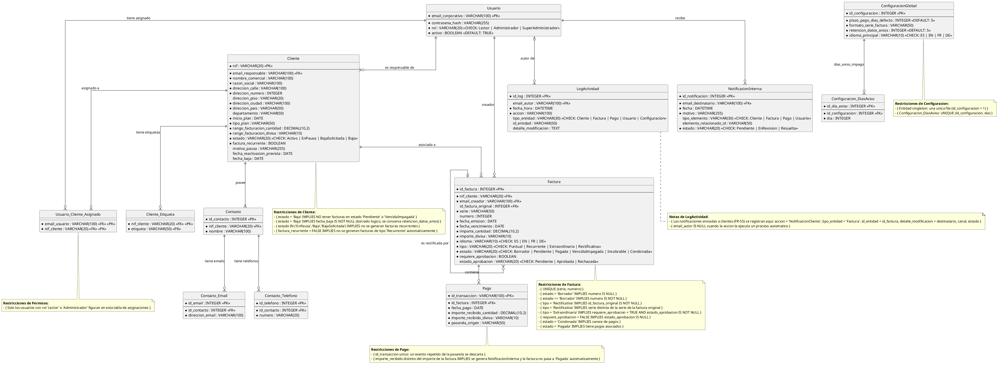

#### Documentación del diagrama E/R

## Alcance

El modelo guarda los datos que necesita LeoncitosManager para llevar la facturación y el seguimiento de cobros de TurbineH, tal y como quedan los requisitos tras la segunda entrega. En concreto:

- Usuarios internos, con su rol y los clientes que tienen asignados (CU-01, CU-07).
- Clientes con sus contactos, etiquetas, departamento y estado de suscripción, incluidas las pausas y las bajas (CU-08).
- Facturas puntuales, recurrentes, extraordinarias y rectificativas, con idioma, flujo de aprobación y estados como incobrable o condonada (CU-02, CU-03).
- Pagos recibidos desde la pasarela simulada de Stripe/Revolut.
- Log de actividad, notificaciones internas y configuración global (CU-09, CU-10).

Quedan fuera la integración con pasarelas reales, el acceso de los clientes a la plataforma y Verifactu. El dashboard (CU-06) no tiene tablas propias: se calcula con consultas sobre Factura y Pago.

---

## Justificación del modelo

### Usuarios y clientes

- Usuario (1) — Cliente (0..N), "responsable": todo cliente tiene un responsable (FR-15), pero un usuario puede no serlo de ninguno.
- Usuario (N) — Cliente (M), "asignación": es una relación muchos a muchos, así que se resuelve con la tabla Usuario_Cliente_Asignado (clave compuesta por email y NIF). Con ella se decide qué clientes ve cada lector.
- Cliente (1) — Cliente_Etiqueta (0..N): en el diagrama de clases las etiquetas son una lista, y una lista no cabe en una sola columna, así que va en su propia tabla.

### Contactos

- Cliente (1) — Contacto (1..N): un cliente tiene al menos un contacto (FR-03).
- Contacto (1) — Contacto_Email (0..N) y Contacto (1) — Contacto_Telefono (0..N): mismo motivo que con las etiquetas, cada contacto puede tener varios emails y teléfonos.

### Facturación

- Cliente (1) — Factura (0..N): un cliente puede no tener facturas todavía.
- Usuario (1) — Factura (0..N), "creador": cada factura guarda quién la creó.
- Factura (0..1) — Factura (0..N), "original": la rectificativa apunta a su original con `id_factura_original`. Una original puede tener varias rectificativas y nunca se borra ni se sustituye (FR-20).
- Factura (1) — Pago (0..N): una factura puede no tener pagos (pendiente, condonada) o tener varios. Un pago siempre pertenece a una factura.

El número de factura (`numero`) es nulo mientras la factura está en borrador, para que los borradores no gasten numeración. Una factura emitida se identifica por el par serie y número. Condonada e incobrable son estados propios y distintos de Pagada, para no falsear los datos financieros.

### Trazabilidad y avisos

- Usuario (0..1) — LogActividad (0..N): cada entrada dice quién hizo qué y sobre qué entidad (`tipo_entidad` e `id_entidad`). El autor es nulo cuando lo hace un proceso automático, como la facturación mensual o los reintentos.
- Usuario (1) — NotificacionInterna (0..N): es la bandeja de cada usuario (FR-63). `elemento_relacionado_id` apunta a la factura, cliente o pago correspondiente.

### Configuración

- ConfiguracionGlobal (1) — Configuracion_DiasAviso (0..N): los días de aviso de impago son una lista, así que van en tabla aparte. ConfiguracionGlobal solo tiene una fila.

Los usuarios no se borran, se desactivan con `activo`, para no perder la referencia en el log y en las facturas que crearon. Los clientes dados de baja se conservan (borrado lógico) y `fecha_baja` marca cuándo empieza a contar el plazo de conservación.

---

## Reglas y restricciones

La notación gráfica no valida nada por sí sola, así que dejamos por escrito qué se comprueba y dónde.

### En la propia base de datos (PK, FK, NOT NULL, UNIQUE, CHECK)

- Claves primarias: email del usuario, NIF del cliente, `id_factura`, `id_transaccion` del pago (si la pasarela repite un evento, no se puede insertar dos veces), y las claves compuestas de Usuario_Cliente_Asignado y Cliente_Etiqueta.
- Factura: `UNIQUE (serie, numero)`. `nif_cliente` y `email_creador` son obligatorios.
- Cliente: `email_responsable` obligatorio.
- Valores cerrados con CHECK: rol, estado de cliente, idioma, tipo y estado de factura, estado de aprobación, estado de notificación interna, `tipo_entidad` y `tipo_elemento`.
- Valores por defecto: plazo de pago de 5 días, retención de 5 años y `activo = TRUE`.
- Configuracion_DiasAviso: `UNIQUE (id_configuracion, dia)`.
- Factura en borrador implica `numero` nulo, y al revés, una factura que no es borrador tiene número.
- Factura rectificativa implica `id_factura_original` no nulo.
- Factura extraordinaria implica `requiere_aprobacion = TRUE` y `estado_aprobacion` no nulo. Si `requiere_aprobacion` es falso, `estado_aprobacion` es nulo.
- Cliente en estado Baja implica `fecha_baja` no nula.

### Reglas que van en triggers o en la aplicación

- Una factura condonada no tiene pagos, y una pagada tiene al menos uno.
- La serie de una rectificativa es distinta de la de su original (FR-20).
- Un cliente en baja no puede tener facturas pendientes ni vencidas (FR-14).
- Los clientes en pausa, con baja solicitada o de baja no generan facturas recurrentes, y los que tienen `factura_recurrente = FALSE` tampoco las generan de forma automática.
- Si el importe de un pago no coincide con el de la factura, la factura no pasa a Pagada: se crea una NotificacionInterna para revisión manual (FR-51, FR-61). Antes de marcar una factura como pagada se verifican sus datos (FR-48).
- Si un proceso automático falla y agota los reintentos (FR-96), se avisa a administradores y superadministradores con una NotificacionInterna y queda anotado en el log.
- Solo los usuarios con rol Lector o Administrador pueden estar en Usuario_Cliente_Asignado.
- Cada cliente debe tener al menos un contacto.
- Una factura emitida no se borra, y pasado el cierre del trimestre tampoco se modifica (RB-03, NFR-15). Los registros del log no se editan ni se eliminan (NFR-20).

---

## Trazabilidad

| Requisitos / casos | Tablas / columnas | Observación |
|---|---|---|
| CU-01, UR-04, RB-01, RB-02, NFR-10, NFR-11, NFR-12 | Usuario | Inicio de sesión. La contraseña solo se guarda con hash. El dominio del correo se valida en la aplicación. |
| CU-07, UR-03, NFR-10 | Usuario (`rol`, `activo`) | Altas, ediciones y desactivación de usuarios. |
| CU-08, UR-06, FR-01, FR-02, FR-03, FR-06 | Cliente, Contacto, Contacto_Email, Contacto_Telefono | Datos comerciales, fiscales y de contacto. |
| FR-07, FR-08, FR-42, FR-43, FR-45 | Cliente (`rango_facturacion_*`, `tipo_plan`, `factura_recurrente`) | Rango anual del que sale la cuota, y si el cliente se factura de forma recurrente o puntual. |
| FR-09, FR-10, FR-12, FR-13, FR-14, NFR-14 | Cliente (`estado`, `motivo_pausa`, `fecha_reactivacion_prevista`, `fecha_baja`) | Pausa y baja son estados distintos. La baja es un borrado lógico. |
| FR-11 | Cliente_Etiqueta | Etiquetas independientes del estado. |
| FR-17 | Cliente (`departamento`) | División de clientes por departamentos de TurbineH. |
| FR-15, NFR-13, RB-07 | Cliente (`email_responsable`), Usuario_Cliente_Asignado | Responsable de cada cliente y acceso del lector solo a sus clientes. |
| CU-03, UR-01, UR-08 | Factura | Creación, serie, número, estados y borradores. |
| FR-20 | Factura (`id_factura_original`, `serie`, `tipo`) | La rectificativa se relaciona con la original sin sustituirla. |
| FR-30 | Factura (`estado`) | El estado de pago se elige entre opciones fijas. |
| FR-37 | Factura (`idioma`) | Facturas en varios idiomas. |
| FR-38 | Factura (`tipo`, `requiere_aprobacion`, `estado_aprobacion`) | Facturas extraordinarias con revisión manual. |
| FR-52, FR-53 | Factura (`estado`: Incobrable, Condonada) | Estados propios, distintos de Pagada. |
| CU-02, UR-02, UR-07 | Factura, Pago, Cliente | Historial de facturas por cliente. |
| FR-47, FR-48, FR-51 | Pago | Pagos de la pasarela simulada. `id_transaccion` evita duplicados. |
| CU-10, UR-05 | ConfiguracionGlobal, Configuracion_DiasAviso | Plazo de pago, formato de serie, retención, idioma y días de aviso. |
| FR-61, FR-63 | NotificacionInterna | Bandeja de tareas e incidencias del usuario. |
| CU-09, UR-07, FR-95, FR-96, NFR-20 | LogActividad | Historial de modificaciones, notificaciones a clientes y fallos de procesos automáticos. |
| CU-06, UR-09, FR-86, FR-87, FR-89 | Consultas sobre Factura y Pago | El dashboard no tiene tablas propias. |

---

## Decisiones abiertas

- **Notificaciones a clientes.** No tienen tabla propia. Cada envío se anota en LogActividad (`accion = 'NotificacionCliente'`, `tipo_entidad = 'Factura'`, y el destinatario, canal y estado en `detalle_modificacion`). Una tabla aparte sería más cómoda para consultar canales y reintentos, pero implicaba añadir una clase nueva al diagrama de clases.
- **Cliente recurrente o puntual.** `factura_recurrente` indica cómo se factura al cliente por defecto, pero no impide que un cliente recurrente reciba una factura puntual o extraordinaria. Eso lo decide `Factura.tipo`.
- **Pagos sin factura identificada.** `Pago.id_factura` es obligatorio. Un pago que no se pueda asociar no se inserta: genera una NotificacionInterna y una entrada en el log para revisarlo a mano. La alternativa era dejar `id_factura` como opcional.
- **Cuota anual inmutable (FR-43).** Si un cliente cambia de rango a mitad de año, la cuota ya facturada se mantiene. No guardamos histórico de rangos, queda reflejado en el importe de las facturas ya emitidas.
- **Tabla de rangos de facturación.** El modelo guarda el rango de cada cliente, pero no una tabla con los rangos y sus cuotas. Pendiente de confirmar con el cliente si el superadministrador debe poder configurarla.
- **Descuentos y precios pactados (FR-45).** No tienen entidad propia. Suponemos que se reflejan en el importe de una factura extraordinaria sujeta a aprobación.
- **Quién aprueba una factura extraordinaria.** No se guarda en Factura, se puede saber por el log. Se podría añadir `email_aprobador` si hace falta.
- **Claves naturales.** Usuario usa su email y Cliente su NIF como clave primaria. Si alguno cambia hay que propagarlo con `ON UPDATE CASCADE`. Preferimos esto a claves artificiales para no complicar el modelo.
- **Tipos de datos.** La divisa es un código (por ejemplo EUR) y los importes son `DECIMAL(10,2)`.

---

## 4. Diagrama UML de clases

#### Diagrama de clases exportado

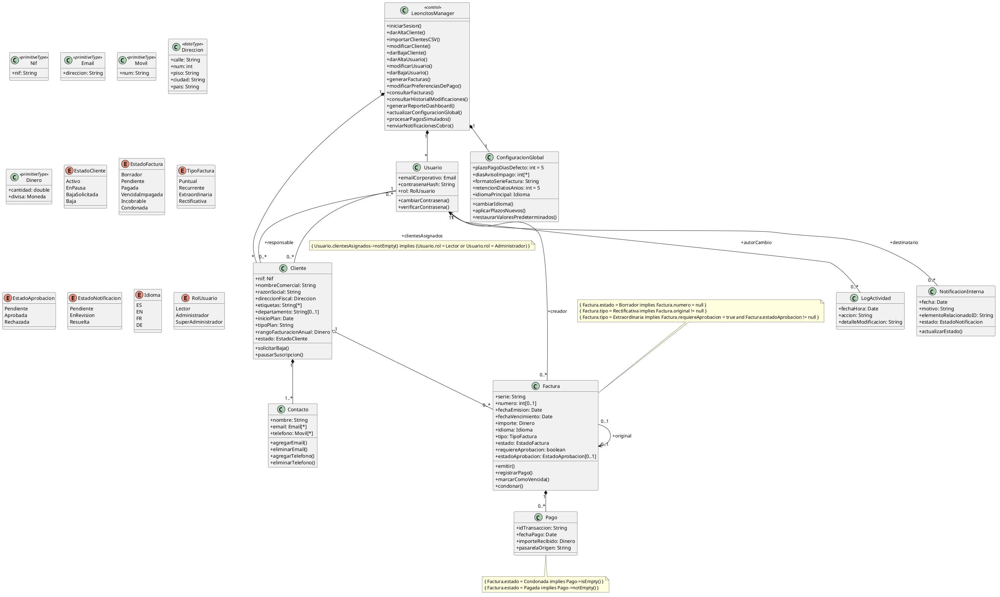

#### Documentación del diagrama de clases

## Alcance

El diagrama recoge la estructura estática del dominio de LeoncitosManager tal y como quedan los requisitos tras la segunda entrega. Incluye:

- La clase de control `LeoncitosManager`, que coordina las operaciones de los casos de uso.
- Usuarios internos con su rol, y su relación con los clientes como responsables o como asignados (CU-01, CU-07).
- Clientes con contactos, etiquetas, departamento y estado de suscripción, incluidas pausas y bajas (CU-08).
- Facturas puntuales, recurrentes, extraordinarias y rectificativas, con idioma, flujo de aprobación y estados como incobrable o condonada (CU-02, CU-03).
- Pagos recibidos desde la pasarela simulada de Stripe/Revolut.
- Configuración global, log de actividad y notificaciones internas (CU-09, CU-10).
- Los tipos de datos (`Nif`, `Email`, `Movil`, `Direccion`, `Dinero`) y las enumeraciones de estados, tipos, idiomas y roles.

Quedan fuera la integración con pasarelas reales, el acceso de los clientes a la plataforma y Verifactu. El dashboard (CU-06) y la documentación de uso (CU-05) no tienen clases propias: el dashboard se resuelve con la operación `generarReporteDashboard` sobre Factura y Pago, y la documentación no forma parte del modelo de dominio.

---

## Decisiones de diseño

### Clase de control

- `LeoncitosManager` (estereotipo `<<control>>`) es el punto de entrada del sistema. Cada operación corresponde a un caso de uso o a un proceso automático (`generarFacturas`, `procesarPagosSimulados`, `enviarNotificacionesCobro`).
- Compone `Cliente`, `Usuario` y una única `ConfiguracionGlobal`, porque su ciclo de vida depende del sistema. Las facturas no se componen aquí: se alcanzan a través de su cliente.
- Las operaciones ilustran responsabilidades, no son firmas finales de implementación.

### Tipos de datos y enumeraciones

- `Nif`, `Email`, `Movil` y `Dinero` son `<<primitiveType>>`: encapsulan un valor con su formato y validación (por ejemplo, el dominio corporativo del email, FR-57), en lugar de usar `String` sueltos.
- `Direccion` es `<<dataType>>`: agrupa calle, número, piso, ciudad y país, y no tiene identidad propia.
- `Dinero` une cantidad y divisa para que ningún importe quede sin moneda. `Moneda` representa un código (por ejemplo EUR).
- Los valores cerrados (estados, tipos, idiomas, roles) son enumeraciones. Así el estado de una factura se elige entre opciones fijas (FR-30) y no se escribe a mano.
- `EstadoFactura` separa `Condonada` e `Incobrable` de `Pagada`, para no falsear los datos financieros (FR-52, FR-53).

### Usuarios

- `Usuario` guarda solo el hash de la contraseña (NFR-11) y se desactiva con `activo` en vez de borrarse, para no perder la referencia en facturas y log.
- Hay dos asociaciones distintas con `Cliente`. `responsable` (1 — 0..*) indica el usuario a cargo de cada cliente (FR-15). `clientesAsignados` (* — *) indica qué clientes puede ver y editar cada usuario (RB-07).
- Una restricción sobre `clientesAsignados` limita las asignaciones a los roles Lector y Administrador; el superadministrador ya tiene acceso total.

### Clientes y contactos

- `Cliente` se identifica por su `nif`. `etiquetas` es multivaluado (FR-11) y `departamento` es opcional (FR-17).
- Pausa y baja son estados distintos de `EstadoCliente`. Sus datos asociados (`motivoPausa`, `fechaReactivacionPrevista`, `fechaBaja`) son opcionales `[0..1]` y solo se rellenan en ese estado (FR-09, FR-10).
- `rangoFacturacionAnual` es de tipo `Dinero` y determina la cuota (FR-07). `facturaRecurrente` indica la modalidad por defecto del cliente (FR-08).
- `Cliente` compone `Contacto` con multiplicidad 1..*: un contacto no existe sin su cliente y todo cliente tiene al menos uno (FR-03). Cada contacto admite varios emails y teléfonos, con operaciones para añadirlos y quitarlos.

### Facturas y pagos

- `Cliente` agrega `Factura` (agregación, no composición). Una factura emitida tiene valor legal propio y se conserva aunque el cliente se dé de baja (FR-12, RB-03).
- `Factura` compone `Pago`: un pago solo existe ligado a una factura. Uno sin factura identificada no se registra y pasa a revisión manual.
- `Factura` conoce a su `creador` (`Usuario`) mediante una asociación navegable en un solo sentido.
- La asociación reflexiva `original` relaciona una rectificativa con la factura que corrige, sin sustituirla (FR-20). Una original puede tener varias rectificativas.
- `numero` es `[0..1]`: un borrador no consume numeración (FR-33) y `emitir()` se la asigna.
- `idioma` cubre las facturas multi-idioma (FR-37). `requiereAprobacion` y `estadoAprobacion` cubren las extraordinarias con revisión manual (FR-38, FR-45).
- `registrarPago`, `marcarComoVencida` y `condonar` concentran en `Factura` los cambios de estado de su ciclo de vida.

### Configuración, trazabilidad y notificaciones

- `ConfiguracionGlobal` es única. Lleva valores por defecto (plazo de 5 días, retención de 5 años) que `restaurarValoresPredeterminados` recupera. `diasAvisoImpago` es una lista configurable.
- `LogActividad` apunta a su `autorCambio` con multiplicidad 0..1: es nulo cuando actúa un proceso automático. No tiene operaciones porque sus registros son inalterables (NFR-20).
- `tipoEntidad` e `idEntidad` en el log, y `elementoRelacionadoID` en las notificaciones, son referencias genéricas. Evitan una asociación por cada clase registrada.
- `NotificacionInterna` forma la bandeja de cada usuario (FR-63). Su `destinatario` es obligatorio y `actualizarEstado` la mueve entre Pendiente, EnRevision y Resuelta.
- Log y notificaciones navegan hacia `Usuario`, pero no al revés: el usuario no necesita conocerlos para operar.

### Restricciones OCL

| Restricción | Significado |
| --- | --- |
| `estado = Borrador implies numero = null` | Un borrador no consume numeración. |
| `tipo = Rectificativa implies original != null` | Toda rectificativa referencia a su original. |
| `tipo = Extraordinaria implies requiereAprobacion = true and estadoAprobacion != null` | Las extraordinarias siempre pasan por aprobación. |
| `estado = Condonada implies Pago->isEmpty()` | Una deuda condonada no tiene pagos. |
| `estado = Pagada implies Pago->notEmpty()` | Una factura pagada tiene al menos un pago. |
| `clientesAsignados->notEmpty() implies rol = Lector or rol = Administrador` | Solo lectores y administradores reciben clientes asignados. |

---

## Trazabilidad

| Requisito / CU | Clases y operaciones | Motivo |
| --- | --- | --- |
| CU-01, UR-04, RB-01, NFR-11 | `LeoncitosManager.iniciarSesion`, `Usuario.verificarContrasena`, `Usuario.cambiarContrasena`, `Email` | Inicio de sesión con correo corporativo y contraseña guardada como hash. |
| CU-07, UR-03, NFR-10 | `LeoncitosManager.darAltaUsuario`, `modificarUsuario`, `darBajaUsuario`, `Usuario` (`rol`, `activo`), `RolUsuario` | Alta, edición y desactivación de usuarios con su rol. |
| CU-08, UR-06, FR-01, FR-02, FR-03 | `LeoncitosManager.darAltaCliente`, `importarClientesCSV`, `modificarCliente`, `Cliente`, `Contacto` (`agregarEmail`, `agregarTelefono`…), `Nif`, `Direccion` | Datos comerciales, fiscales y de contacto, alta individual o masiva por CSV. |
| FR-09, FR-10, FR-12, FR-13, FR-14 | `LeoncitosManager.darBajaCliente`, `Cliente.solicitarBaja`, `Cliente.pausarSuscripcion`, `EstadoCliente` | Pausa y baja como estados distintos; la baja es un borrado lógico. |
| FR-11, FR-17 | `Cliente.etiquetas`, `Cliente.departamento` | Etiquetado flexible y división por departamentos. |
| FR-15, RB-07, NFR-13 | Asociaciones `responsable` y `clientesAsignados` entre `Usuario` y `Cliente` | Responsable de cada cliente y acceso del lector solo a sus clientes. |
| FR-07, FR-08, FR-42, FR-43 | `Cliente.rangoFacturacionAnual`, `Cliente.tipoPlan`, `Cliente.facturaRecurrente`, `Dinero` | Rango anual del que sale la cuota y modalidad de facturación. |
| CU-04 | `LeoncitosManager.modificarPreferenciasDePago`, `Cliente` | Cambio de las condiciones de pago de un cliente. |
| CU-03, UR-01, UR-08 | `LeoncitosManager.generarFacturas`, `Factura.emitir`, `Factura` → `creador`, `TipoFactura` | Creación de facturas puntuales y recurrentes, y emisión con numeración. |
| FR-20 | Asociación `original` de `Factura`, `Factura.serie` | La rectificativa se relaciona con la original sin sustituirla. |
| FR-30 | `Factura.estado`, `EstadoFactura` | El estado se elige entre opciones fijas. |
| FR-37 | `Factura.idioma`, `Idioma` | Facturas en varios idiomas. |
| FR-38, FR-45 | `Factura.requiereAprobacion`, `Factura.estadoAprobacion`, `EstadoAprobacion` | Facturas extraordinarias y descuentos con revisión manual. |
| FR-52, FR-53 | `Factura.condonar`, `EstadoFactura` (`Incobrable`, `Condonada`) | Estados propios, distintos de Pagada. |
| CU-02, UR-02, UR-07 | `LeoncitosManager.consultarFacturas`, `Cliente`, `Factura`, `Pago` | Historial de facturas por cliente y su estado de cobro. |
| FR-47, FR-48, FR-51 | `LeoncitosManager.procesarPagosSimulados`, `Factura.registrarPago`, `Factura.marcarComoVencida`, `Pago` | Pagos de la pasarela simulada; `idTransaccion` evita duplicados. |
| UR-01 | `LeoncitosManager.enviarNotificacionesCobro`, `ConfiguracionGlobal.diasAvisoImpago`, `LogActividad` | Recordatorios y avisos de impago al cliente, anotados en el log. |
| FR-61, FR-63 | `NotificacionInterna` (`actualizarEstado`), asociación `destinatario`, `EstadoNotificacion` | Bandeja de tareas e incidencias de cada usuario. |
| CU-06, UR-09, FR-86, FR-87, FR-89 | `LeoncitosManager.generarReporteDashboard` sobre `Factura` y `Pago` | El dashboard se calcula, no tiene clase propia. |
| CU-09, UR-07, FR-95, NFR-20 | `LeoncitosManager.consultarHistorialModificaciones`, `LogActividad`, asociación `autorCambio` | Historial de quién cambió qué y cuándo. |
| FR-96 | `LogActividad` (autor nulo), `NotificacionInterna` | Fallos de procesos automáticos tras agotar los reintentos. |
| CU-10, UR-05 | `LeoncitosManager.actualizarConfiguracionGlobal`, `ConfiguracionGlobal` (`cambiarIdioma`, `aplicarPlazosNuevos`, `restaurarValoresPredeterminados`) | Plazo de pago, serie, retención, idioma y días de aviso. |

---

## Consistencia con otros modelos

No toda clase implica una tabla, ni toda tabla procede de una clase. La correspondencia con el modelo físico de datos es la siguiente:

| Elemento del diagrama de clases                                                                                   | Elemento del E-R                                   | Observación                                                           |
| ----------------------------------------------------------------------------------------------------------------- | -------------------------------------------------- | --------------------------------------------------------------------- |
| `Usuario`, `Cliente`, `Contacto`, `Factura`, `Pago`, `ConfiguracionGlobal`, `LogActividad`, `NotificacionInterna` | Tabla homónima                                     | Clases de entidad con tabla propia.                                   |
| `LeoncitosManager`                                                                                                | Sin tabla                                          | Clase de control. Sus composiciones no se traducen a claves foráneas. |
| `Cliente.etiquetas`                                                                                               | `Cliente_Etiqueta`                                 | Atributo multivaluado llevado a tabla aparte.                         |
| `Contacto.email`, `Contacto.telefono`                                                                             | `Contacto_Email`, `Contacto_Telefono`              | Atributos multivaluados llevados a tabla aparte.                      |
| `ConfiguracionGlobal.diasAvisoImpago`                                                                             | `Configuracion_DiasAviso`                          | Atributo multivaluado; `ConfiguracionGlobal` tiene una sola fila.     |
| Asociación `clientesAsignados`                                                                                    | `Usuario_Cliente_Asignado`                         | Tabla intermedia con clave compuesta por email y NIF.                 |
| Asociación `responsable`                                                                                          | `Cliente.email_responsable`                        | Clave foránea obligatoria.                                            |
| Agregación `Cliente`-`Factura`                                                                                    | `Factura.nif_cliente`                              | Clave foránea obligatoria.                                            |
| Composición `Factura`-`Pago`                                                                                      | `Pago.id_factura`                                  | Clave foránea obligatoria; un pago sin factura no se inserta.         |
| Asociación `creador`                                                                                              | `Factura.email_creador`                            | Clave foránea obligatoria.                                            |
| Asociación reflexiva `original`                                                                                   | `Factura.id_factura_original`                      | Clave foránea opcional hacia la propia tabla.                         |
| Asociación `autorCambio`                                                                                          | Clave foránea opcional en `LogActividad`           | Nula cuando actúa un proceso automático.                              |
| Asociación `destinatario`                                                                                         | Clave foránea obligatoria en `NotificacionInterna` | Bandeja de cada usuario.                                              |
| `Nif`, `Email`, `Movil`                                                                                           | Columnas simples                                   | Los tipos primitivos no generan tabla.                                |
| `Direccion`                                                                                                       | Columnas de `Cliente`                              | El tipo de dato se aplana en sus campos.                              |
| `Dinero`                                                                                                          | Dos columnas: importe `DECIMAL(10,2)` y divisa     | Por ejemplo `rango_facturacion_*` en `Cliente`.                       |
| Enumeraciones                                                                                                     | Restricciones `CHECK`                              | Rol, estados, tipo de factura e idioma.                               |

Otras correspondencias:

- **Identificadores.** `Usuario` y `Cliente` usan su email y su NIF como clave, igual que en el E-R. `Factura` lleva en el E-R una clave artificial `id_factura`, porque `numero` es nulo en los borradores; en el diagrama la identidad la aporta el propio objeto.
- **Restricciones OCL.** Las de borrador sin número, rectificativa con original y extraordinaria con aprobación se implementan como `CHECK`. Las de pagos en facturas condonadas o pagadas y la de roles en `clientesAsignados` van en triggers o en la aplicación.
- **Dashboard.** No tiene clase ni tabla; `generarReporteDashboard` se apoya en consultas sobre `Factura` y `Pago`.
- **Decisiones compartidas.** Las notificaciones a clientes no tienen clase ni tabla y se anotan en `LogActividad`. Los descuentos y precios pactados se reflejan en el importe de una factura extraordinaria. La tabla de rangos de facturación sigue pendiente de confirmar en ambos modelos.
- **Casos de uso.** Cada operación pública de `LeoncitosManager` corresponde a un caso de uso (CU-01 a CU-10, salvo CU-05) o a un proceso automático, lo que sirve de enlace con los diagramas de secuencia.

---

## 5. Diagramas UML de secuencia

### CU-01: Autenticación de usuario

#### Diagrama CU-01 exportado

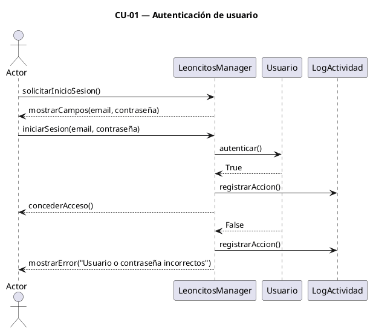

#### Documentación del diagrama CU-01

1. El `Actor` solicita iniciar sesión (`solicitarInicioSesion()`) y `LeoncitosManager` le muestra los campos de correo corporativo y contraseña (`mostrarCampos(email, contraseña)`).

2. Dentro de un bucle (`loop`) hasta lograr autenticarse, el `Actor` envía sus credenciales (`iniciarSesion(email, contraseña)`) y `LeoncitosManager` delega la validación de dominio (`@turbineh`) y credenciales en `Usuario` (`autenticar()`).

3. **Si son válidas (`alt`):** `Usuario` devuelve `True`, `LeoncitosManager` registra el acceso en `LogActividad` (`registrarAccion()`) y concede acceso al sistema (`concederAcceso()`).

4. **Si son incorrectas (`else`):** `Usuario` devuelve `False`, se registra el intento fallido en `LogActividad` (`registrarAccion()`) y se muestra el error `"Usuario o contraseña incorrectos"`.

---

### CU-02: Consulta del historial de facturas

#### Diagrama CU-02 exportado

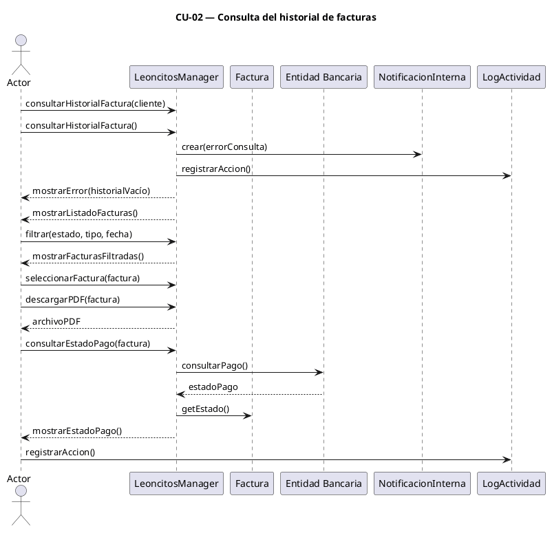

#### Documentación del diagrama CU-02

1. El `Actor` elige entre consultar el historial de un cliente concreto (`consultarHistorialFactura(cliente)`) o el historial global de sus clientes asignados (`consultarHistorialFactura()`).

2. **Si hay error de BD o el cliente no existe (`alt`):** `LeoncitosManager` crea una incidencia en `NotificacionInterna` (`crear(errorConsulta)`), registra el fallo en `LogActividad` (`registrarAccion()`) y devuelve un listado vacío con el error (`mostrarError(historialVacío)`).

3. **Si la consulta es correcta (`else`):** se muestra el listado de facturas (`mostrarListadoFacturas()`). De forma opcional (`opt`), el usuario puede filtrar por estado, tipo y fecha (`filtrar(estado, tipo, fecha)`).

4. Tras seleccionar una factura (`seleccionarFactura(factura)`), el usuario puede opcionalmente (`opt`) descargar su PDF (`descargarPDF(factura)`) o comprobar su estado de pago (`consultarEstadoPago(factura)`), en cuyo caso `LeoncitosManager` consulta a la `Entidad Bancaria` (`consultarPago()`) y verifica el estado interno en `Factura` (`getEstado()`). Finalmente, se registra la consulta en `LogActividad` (`registrarAccion()`).

---

### CU-03: Generación de facturas

#### Diagrama CU-03 exportado

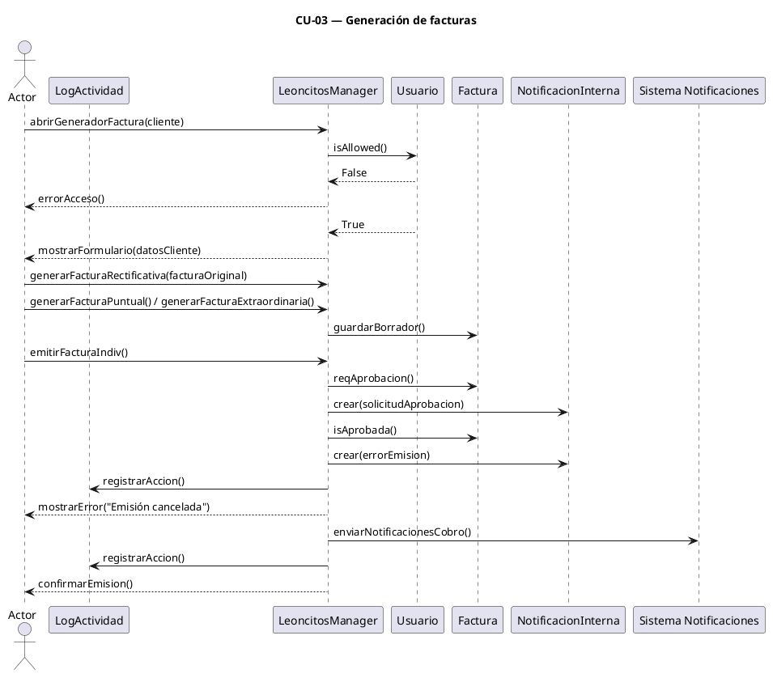

#### Documentación del diagrama CU-03

1. El `Actor` abre el generador desde el perfil de un cliente (`abrirGeneradorFactura(cliente)`) y `LeoncitosManager` comprueba los permisos en `Usuario` (`isAllowed()`). Si no tiene permisos (`alt`), devuelve `errorAcceso()`.

2. Con permisos (`else`), se muestra el formulario con los datos autocompletados del cliente (`mostrarFormulario(datosCliente)`). El usuario elige entre crear una factura rectificativa vinculada a la original (`generarFacturaRectificativa(facturaOriginal)`) o una puntual/extraordinaria (`generarFacturaPuntual() / generarFacturaExtraordinaria()`).

3. Opcionalmente (`opt`), si cierra sin emitir, se guarda como borrador en `Factura` (`guardarBorrador()`).

4. Al emitir (`emitirFacturaIndiv()`), se comprueba si requiere aprobación (`reqAprobacion()`). En caso afirmativo (`opt`), se crea una solicitud en `NotificacionInterna` (`crear(solicitudAprobacion)`) y se verifica su aprobación (`isAprobada()`).

5. **Si falla el guardado en BD (`alt`):** se crea una alerta en `NotificacionInterna` (`crear(errorEmision)`), se audita en `LogActividad` (`registrarAccion()`) y se notifica `"Emisión cancelada"`.

6. **Si se guarda correctamente (`else`):** `LeoncitosManager` avisa al `Sistema Notificaciones` (`enviarNotificacionesCobro()`), registra la emisión en `LogActividad` (`registrarAccion()`) y confirma al usuario (`confirmarEmision()`).

---

### CU-04: Modificación de preferencias de pago

#### Diagrama CU-04 exportado

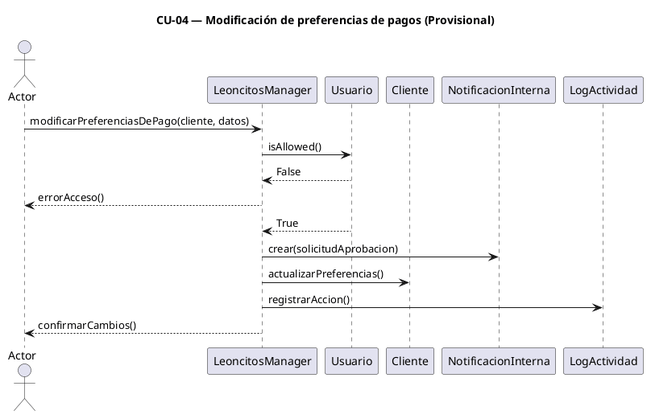

#### Documentación del diagrama CU-04

1. El `Actor` solicita actualizar las condiciones de pago o tarifa de un cliente (`modificarPreferenciasDePago(cliente, datos)`).

2. `LeoncitosManager` verifica los permisos mediante `Usuario.isAllowed()`. Si devuelve `False`, retorna `errorAcceso()`.

3. Si devuelve `True`, en caso de tratarse de un descuento extraordinario o precio pactado (`opt`), se genera una solicitud en `NotificacionInterna` (`crear(solicitudAprobacion)`).

4. `LeoncitosManager` actualiza los datos en `Cliente` (`actualizarPreferencias()`), deja traza en `LogActividad` (`registrarAccion()`) y confirma los cambios al usuario (`confirmarCambios()`).

---

### CU-05: Consulta de documentación

#### Diagrama CU-05 exportado

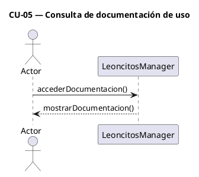

#### Documentación del diagrama CU-05

1. El `Actor` selecciona la pestaña de ayuda/documentación desde el menú principal (`accederDocumentacion()`).

2. `LeoncitosManager` recupera y muestra la guía de uso del sistema (`mostrarDocumentacion()`), sin alterar el estado ni los registros del sistema.

---

### CU-06: Acceso al dashboard de facturación

#### Diagrama CU-06 exportado

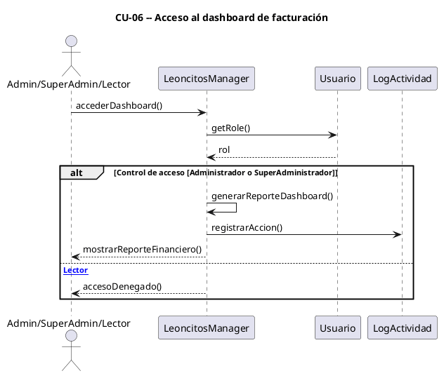

#### Documentación del diagrama CU-06

1. El `Actor` (Administrador/SuperAdministrador/Lector) solicita acceder al dashboard (`accederDashboard()`) y `LeoncitosManager` consulta el rol del usuario en `Usuario` (`getRole()`), que devuelve el rol correspondiente (`rol`).

2. **Si es Administrador o SuperAdministrador (`alt`):** `LeoncitosManager` genera el informe financiero (`generarReporteDashboard()`), registra la consulta en `LogActividad` (`registrarAccion()`) y devuelve el informe al usuario (`mostrarReporteFinanciero()`).

3. **Si es Lector (`else`):** `LeoncitosManager` deniega el acceso al dashboard y comunica el resultado al usuario (`accesoDenegado()`), sin generar el informe financiero.

---

### CU-07: Gestión de usuarios del sistema

#### Diagrama CU-07 exportado

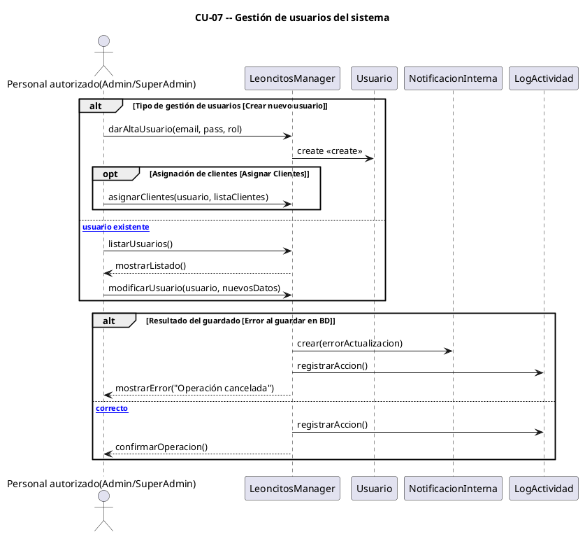

#### Documentación del diagrama CU-07

1. El `Actor` (Administrador/SuperAdministrador) elige entre crear un nuevo usuario (`darAltaUsuario(email, pass, rol)`) o editar uno existente (`alt`).

2. **Si crea un usuario (`alt`):** `LeoncitosManager` genera una nueva instancia de `Usuario` mediante un mensaje de creación (`create`). De forma opcional (`opt`), el administrador puede asignar clientes al usuario recién creado (`asignarClientes(usuario, listaClientes)`).

3. **Si edita un usuario existente (`else`):** `LeoncitosManager` solicita el listado de usuarios (`listarUsuarios()`), muestra los resultados (`mostrarListado()`) y permite modificar los datos del usuario seleccionado (`modificarUsuario(usuario, nuevosDatos)`).

4. **Si se produce un error al guardar en BD (`alt`):** `LeoncitosManager` crea una incidencia en `NotificacionInterna` (`crear(errorActualizacion)`), registra el fallo en `LogActividad` (`registrarAccion()`) y muestra el mensaje `"Operación cancelada"` (`mostrarError()`).

5. **Si el guardado es correcto (`else`):** `LeoncitosManager` registra la operación en `LogActividad` (`registrarAccion()`) y confirma el resultado al usuario (`confirmarOperacion()`).

---

### CU-08: Gestión de clientes

#### Diagrama CU-08 exportado

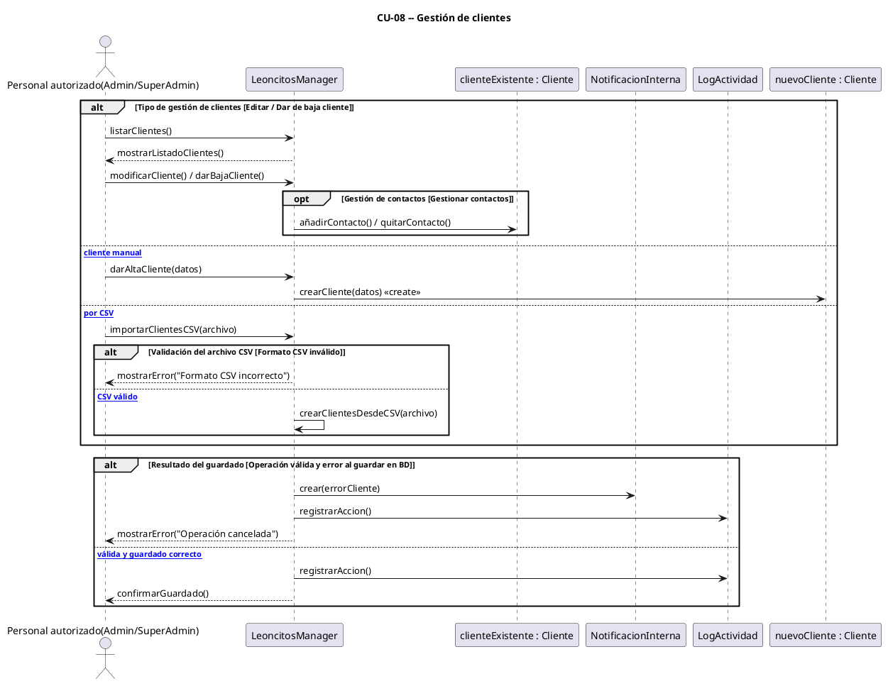

#### Documentación del diagrama CU-08

1. El `Actor` (Administrador/SuperAdministrador) elige entre editar o dar de baja un cliente existente, crear un cliente manualmente o importar clientes mediante un archivo CSV (`alt`).

2. **Si edita o da de baja un cliente (`alt`):** `LeoncitosManager` solicita el listado de clientes (`listarClientes()`), muestra los resultados (`mostrarListadoClientes()`) y permite modificar los datos o solicitar la baja (`modificarCliente() / darBajaCliente()`). De forma opcional (`opt`), se pueden gestionar los contactos del cliente existente (`añadirContacto() / quitarContacto()`) mediante la instancia `clienteExistente:Cliente`.

3. **Si crea un cliente manualmente (`else`):** el actor introduce los datos correspondientes (`darAltaCliente(datos)`) y `LeoncitosManager` genera una nueva instancia `nuevoCliente:Cliente` mediante un mensaje de creación (`crearCliente(datos)`).

4. **Si importa clientes mediante CSV (`else`):** el actor selecciona y envía el archivo (`importarClientesCSV(archivo)`). Si el formato es inválido (`alt`), `LeoncitosManager` muestra el error `"Formato CSV incorrecto"`. Si el formato es válido (`else`), ejecuta internamente el proceso de importación y creación de clientes (`crearClientesDesdeCSV(archivo)`).

5. **Si la operación es válida, pero se produce un error al guardar en BD (`alt`):** `LeoncitosManager` crea una incidencia en `NotificacionInterna` (`crear(errorCliente)`), registra el fallo en `LogActividad` (`registrarAccion()`) y muestra el mensaje `"Operación cancelada"`.

6. **Si la operación es válida y el guardado es correcto (`else`):** `LeoncitosManager` registra la operación en `LogActividad` (`registrarAccion()`) y confirma el resultado al usuario (`confirmarGuardado()`).

---

### CU-09: Consulta historial de modificaciones

#### Diagrama CU-09 exportado

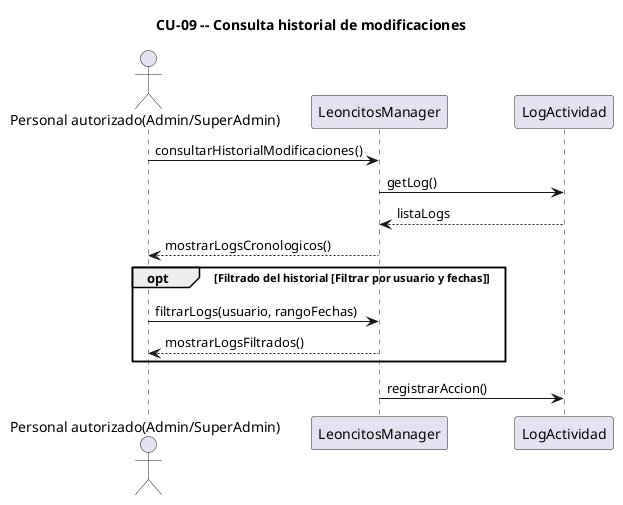

#### Documentación del diagrama CU-09

1. El `Actor` (Administrador/SuperAdministrador) solicita consultar el historial de modificaciones (`consultarHistorialModificaciones()`).

2. `LeoncitosManager` solicita los registros almacenados a `LogActividad` (`getLog()`), recibe el listado de modificaciones (`listaLogs`) y muestra los resultados ordenados cronológicamente (`mostrarLogsCronologicos()`).

3. De forma opcional (`opt`), el usuario puede filtrar los registros por usuario y rango de fechas (`filtrarLogs(usuario, rangoFechas)`). `LeoncitosManager` devuelve los resultados correspondientes (`mostrarLogsFiltrados()`).

4. Finalmente, `LeoncitosManager` registra la consulta realizada en `LogActividad` (`registrarAccion()`).

---

### CU-10: Modificación de configuración global

#### Diagrama CU-10 exportado

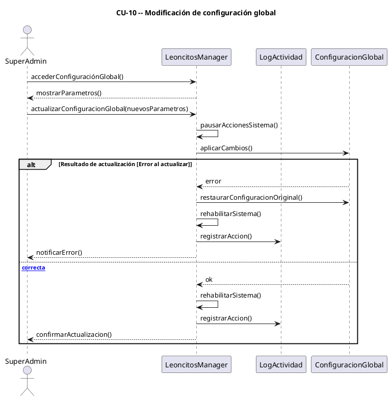

#### Documentación del diagrama CU-10

1. El `Actor` (SuperAdministrador) accede a la configuración global (`accederConfiguracionGlobal()`) y `LeoncitosManager` muestra los parámetros actuales del sistema (`mostrarParametros()`).

2. El actor solicita modificar los parámetros (`actualizarConfiguracionGlobal(nuevosParametros)`). `LeoncitosManager` pausa internamente las acciones del sistema (`pausarAccionesSistema()`) y solicita a `ConfiguracionGlobal` aplicar los nuevos valores (`aplicarCambios()`).

3. **Si se produce un error al actualizar (`alt`):** `ConfiguracionGlobal` devuelve el resultado de error (`error`), `LeoncitosManager` solicita restaurar la configuración original (`restaurarConfiguracionOriginal()`), rehabilita el sistema (`rehabilitarSistema()`), registra el fallo en `LogActividad` (`registrarAccion()`) y notifica el error al Superadministrador (`notificarError()`).

4. **Si la actualización es correcta (`else`):** `ConfiguracionGlobal` devuelve el resultado satisfactorio (`ok`), `LeoncitosManager` rehabilita el sistema (`rehabilitarSistema()`), registra la modificación en `LogActividad` (`registrarAccion()`) y confirma la actualización al Superadministrador (`confirmarActualizacion()`).

---

## 6. Arquitectura y componentes

#### Diagrama de arquitectura exportado

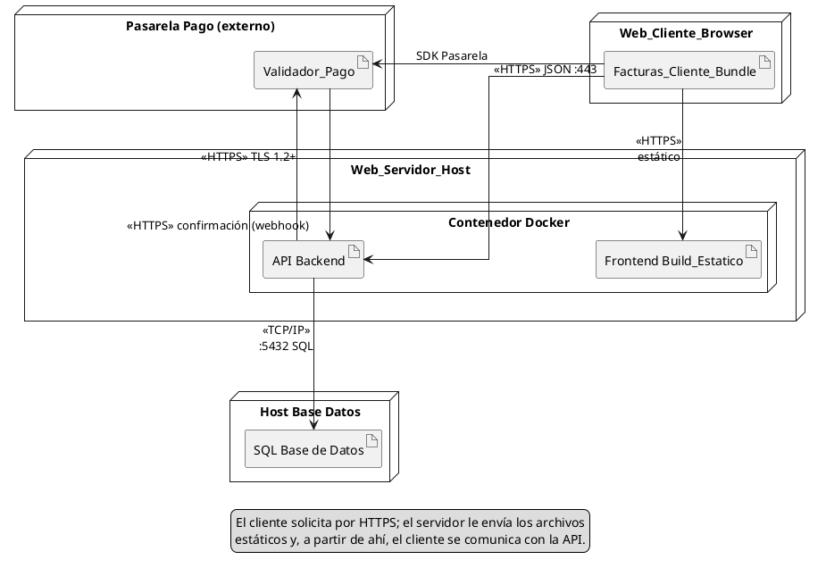

#### Documentación del diagrama de arquitectura

X

---

## 7. Informe Scrum

### Identificación del equipo

| Luis San Juan          | Miembro del equipo |
| ---------------------- | ------------------ |
| Daniel Delgado         | Scrum Máster       |
| Wail Amchi El Haskouri | Product Owner      |
| José Javier Jimenez    | Miembro del equipo |
| Daniel López           | Miembro del equipo |
| Jesús García           | Miembro del equipo |
| Fernando Montero       | Miembro del equipo |

### Reuniones del periodo

| Fecha      | Inicio | Duración            | Participantes                                                        | Temas y acuerdos                                                                                                                                                                                                                         |
| ---------- | ------ | ------------------- | -------------------------------------------------------------------- | ---------------------------------------------------------------------------------------------------------------------------------------------------------------------------------------------------------------------------------------- |
| 05/11/2026 | 8:45   | 1 hora y 45 minutos | - Luis - Daniel L.  - Daniel D. - José - Wail - Jesús | Organización de los puntos del trabajo a realizar, inicio de los diagramas de secuencia pero por consejo del profesorado lo dejaremos para más adelante.                                                                                 |
| 10/11/2026 | 12:30  | 30 min              | - Luis - Daniel D. - Jesús - Wail                           | Reunión para la revisión del trabajo con Jose Luis Subirats.                                                                                                                                                                             |
| 12/11/2026 | 8:45   | 1 hora y 45 minutos | - Luis - Daniel L. - Daniel D. - José - Wail - Jesús  | Realizacion de cada parte por los miembros del grupo correspondientes (Corrección de la entrega 1 e inicio de los diagramas de clase) y planteamiento de una futura reunión para aclarar dudas y afianzar más la gestión de esta entrega |
| 19/11/2026 | 8:45   | 1 hora y 45 minutos | - Luis - Daniel L. - José - Wail                            | Continuación con tareas repartidas sobre elaboración de diagramas.                                                                                                                                                                       |
| 24/11/2026 | 20:00  | 1 hora              | - Luis - Daniel L. - Daniel D. - José - Wail - Jesús  | Avances finales sobre diagramas de la Entrega 2: arquitectura, secuencias, clases, y entidad-relación.                                                                                                                                   |
| 26/11/2026 | 8:45   | 1 hora y 45 minutos | - Luis - Daniel L. - Daniel D. - José - Wail - Jesús  | Retoques finales de coherencia y elaboración de informes y documentación de diagramas.                                                                                                                                                   |
 
### Estado del product backlog y Sprint backlog

**Tablero:** [sustituir por URL real](https://example.org/REEMPLAZAR).

Añadir **capturas reales legibles** del estado del tablero en Sprint Planning y Sprint Retrospective. Copiar las imágenes a `entrega2/evidencias/` y enlazarlas así (descomentar con archivos existentes):

#### Estado del tablero en el Sprint Planning

| Estado                               | Tareas                                                                                                                                                                                 |
| ------------------------------------ | -------------------------------------------------------------------------------------------------------------------------------------------------------------------------------------- |
| Tareas pendientes de la Entrega      | - Actualizar infrome Scrum de la Entrega 2. - Corrección de la Entrega 1. - Realización de los diagramas de clase. - Diagrama de Arquitectura.                                |
| Tareas omitidas del Sprint actual    | - Diagrama de secuencia. - Sintetización de conclusiones y referencias.                                                                                                             |
| En progreso                          | - Informe Scrum. - Identificación y documentación de requisitos.                                                                                                                    |
| En revisión                          | ...                                                                                                                                                                                    |
| Completado                           | ...                                                                                                                                                                                    |

#### Estado del tablero en la Sprint Retrospective

| Qué hacer  | Qué hemos hecho                                                                                                                                                                                                                                                                    |
| ---------- | ---------------------------------------------------------------------------------------------------------------------------------------------------------------------------------------------------------------------------------------------------------------------------------- |
| Mantener   | - La creación y uso del repositorio de GitHub para facilitar la contribución del equipo en cualquier momento. - La alta tasa de tareas completadas durante las sesiones. - El trabajo individual y su posterior puesta en común para dar con nuevas ideas y puntos de vista. |
| Mejorar    | - La definición y estructuración de los requisitos (tanto funcionales como no funcionales). - La resolución de dudas para definir el alcance exacto del sistema de facturación.                                                                                                 |
| Cambiar    | - Completar la asignación de roles al inicio, ya que fue la única tarea planificada que no se finalizó. - Asegurar la disponibilidad de transcripciones completas de las charlas antes de documentar, para evitar que falten especificaciones.                                  |

### Información de tareas

| Tarea                                                  | Responsable       | Milestone             | Prioridad | Etiqueta     | Descripción / estado                                                            |
| ------------------------------------------------------ | ----------------- | --------------------- | --------- | ------------ | ------------------------------------------------------------------------------- |
| Especificación de casos de uso                         | Daniel L. y Wail  | Entrega 1 actualizada | Alta      | casos de uso | Añadir casos de uso que faltaron en la 1a entrega                               |
| Actualización de requisitos                            | Jesús y Daniel L. | Entrega 1 actualizada | Alta      | requisitos   | Actualizar requisitos en función de los informes de feedback tras la 1a entrega |
| Informe Scrum                                          | Luis              | Entrega 2             | Media     | scrum        | Mantener actualizado el informe Scrum de esta entrega                           |
| Diagrama de arquitectura                               | Daniel D.         | Entrega 2             | Media     | diagramas    | Elaborar diagrama de arquitectura y documentarlo                                |
| Diagramas de clase                                     | Wail y Jesús      | Entrega 2             | Media     | diagramas    | Elaborar diagrama de clases y documentarlo                                      |
| Diagramas de secuencia (1-5)                           | Luis              | Entrega 2             | Media     | diagramas    | Elaborar diagramas de secuencias 1 a 5 y documentarlos                          |
| Diagramas de secuencia (6-10)                          | José              | Entrega 2             | Media     | diagramas    | Elaborar diagramas de secuencias 6 a 10 y documentarlos                         |
| Diagrama E/R                                           | Jesús             | Entrega 2             | Media     | diagramas    | Elaborar diagramas entidad-relación y documentarlo                              |
| Restructuración y mantenimiento del repositorio GitHub | Daniel L.         | Entrega 2             | Media     | repositorio  | Restructurar el repo según la plantilla proporcionada para la 2da entrega       |

### Problemas y riesgos

| Sprint   | Problema/riesgo                                                               | Impacto                               | Medida aplicada                                                 | Estado                              |
| -------- | ----------------------------------------------------------------------------- | ------------------------------------- | --------------------------------------------------------------- | ----------------------------------- |
| Sprint 1 | Actualización de requisitos                                                   | Retraso en tareas de Entrega 2        | Repaso del feedback proporcionado                               | Terminado                           |
| Sprint 1 | Especificaciones de casos de uso                                              | Retraso en tareas de Entrega 2        | Realización de las especificaciones                             | Terminado                           |
| Sprint 2 | Diagramas de secuencia en formato `.mdj` (`.puml` requerido)                  | Requisito necesario para la Entrega 2 | Pudimos pasarlos a PlantUML empleando extensiones y ayuda de IA | Terminado                           |
| Sprint 2 | Confusión sobre qué evidencias presentar exactamente en `Entrega2/evidencias` | Duda no resuelta para la Entrega 2    | Presentar capturas de commits y branches de GitKraken y GitHub  | Confirmación pendiente del profesor |

### Revisión y retrospectiva

- **Logros:**
	- Primera definición de funciones y métodos del sistema para el diagrama de clases.
	- Reuniones fuera de horario académico.
	- Actualización mediante revisión exhaustiva de documentos de la Entrega 1.

- **Aspectos positivos:**
	- Contraste de decisiones del equipo con feedback de profesores y del cliente.
	- Revisión de especificaciones de casos de uso para asegurar coherencia con requisitos y demás características del sistema ya definidas.
	- Mantenimiento de la plantilla de entrega proporcionada en el repositorio.
	- Reparto/división eficiente de tareas.

- **Mejoras:**
	- Requisitos más coherentes y específicos.
	- Especificaciones de casos de uso incluidas (faltaban en la Entrega 1).
	- Trazabilidad de errores del sistema.

- **Acciones siguientes:**
	- Repaso de diagramas de Entrega2 con el feedback proporcionado.
	- Tomar nota de las validaciones/objeciones del cliente (Alejandro) con respecto a nuestro trabajo realizado.

